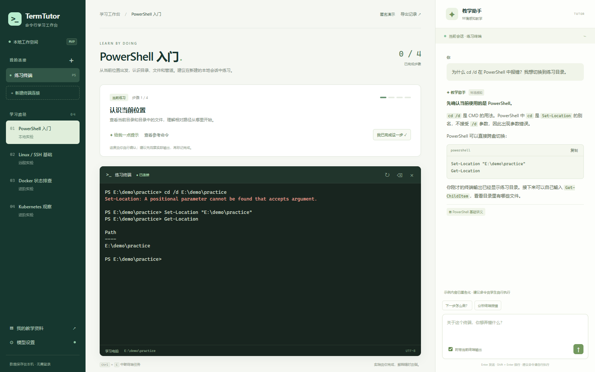

# 单机 MVP 运行效果与单流实测

记录日期：2026-11-01（Asia/Shanghai）。本文件记录已运行的效果和短测结果，不包含设计方案或本机部署配置明细。

## 运行效果



图中连接、终端和回答内容使用匿名示例，避免公开真实用户名、主机名、目录清单、路径和会话标识。

已完成的主要闭环：

- 学生在真实 PowerShell 终端输入命令，支持交互输入、Ctrl+C 和窗口尺寸同步；本地目录变化可被助手观察。
- 教学侧栏绑定选中的会话，结合近期终端输出、本地讲义和环境观察工具给出流式解释。
- 例如把 CMD 的 `cd /d` 用法带到 PowerShell 时，助手能结合报错说明差异，并提示使用 `Set-Location` 或直接 `cd` 到完整路径。命令由学生检查后自行执行。
- 四组课程提供逐步目标和参考命令；学习进度为学生自评，刷新页面后对话与进度仍可查看。
- 支持导入 Markdown/TXT 教学资料、查看实际检索出处、导出学习记录；模型故障时明确切换为离线提示。

真实模型工具调用和本机浏览器交互已做轻量验收。SSH 与串口入口已接入，但没有可用的远端主机或物理设备用于实连验收，不据此宣称两项已实测。

## 模型单流输出速度

2026-11-01 17:33（Asia/Shanghai），使用当前已加载模型，从本机 OpenAI 兼容 SSE 接口进行一次预热和三次串行请求。脚本自身并发数始终为 1，没有调用终端观察或资料检索工具。

| 样本 | 输入 token | 输出 token | 首字等待 | 首末输出间隔 | 总耗时 | 生成速度 | 含首字等待的吞吐 |
|---|---:|---:|---:|---:|---:|---:|---:|
| 1 | 70 | 384 | 0.087 s | 4.303 s | 4.390 s | 89.02 token/s | 87.48 token/s |
| 2 | 70 | 384 | 0.111 s | 4.288 s | 4.399 s | 89.32 token/s | 87.29 token/s |
| 3 | 70 | 384 | 0.094 s | 4.316 s | 4.411 s | 88.74 token/s | 87.06 token/s |
| **中位数** | **70** | **384** | **0.094 s** | **4.303 s** | **4.399 s** | **89.02 token/s** | **87.29 token/s** |

测量口径：

1. 一次 16 token 预热，不计入三次结果；三次使用相同短提示，temperature=0，每次输出上限为 384 token，结束原因均为 `length`。这是受控短输出样本，不是回答完整度测试。
2. token 数采用服务端 `usage.completion_tokens`，不根据中文字数或字符数估算。本次每条 SSE 内容块恰好对应一个输出 token。
3. 首字等待从发送请求前到收到首个非空可见文本块。它包含请求传输、排队、提示处理和首个输出，不是独立的纯提示处理耗时。
4. 生成速度 = `(输出 token 数 - 1) / (最后文本块时间 - 首个文本块时间)`。含首字等待的吞吐 = `输出 token 数 / 请求总耗时`。这是客户端观测值，不是推理引擎内部计时。
5. 相同提示可能命中已预热的提示缓存，所以 **0.094 s 不能用于预测新终端长上下文的首字延迟**。本次不卸载模型、不修改服务端并行槽位，也不限制其他客户端；脚本仅保证自己的请求串行发送。

完整教学问答还会增加课程检索、终端上下文处理及可能的多轮模型工具调用。本轮 MVP 验收中的一次“观察环境后解释命令”完整请求约 11 秒；其测试提示、输出长度和缓存状态均与本表不同，不能将其换算为单流 token/s 或保证日常响应时间。

## 复测

先准备本地 `.env` 或环境变量，再用自己的 Conda Python 执行：

```powershell
& 'D:\anaconda\envs\py311\python.exe' mvp/benchmark.py
```

默认一次预热、三次串行请求、每次最多 384 个输出 token。结果写入已忽略的 `mvp/data/benchmark-result.json`，仅包含提示、计时和计数，不包含接口地址、模型账号前缀、API Key 或原始生成内容。源码见 [benchmark.py](mvp/benchmark.py)。

本报告只反映该电脑、当前已加载模型和当时运行状态的短测样本，不是不同硬件、量化版本、长上下文或多人并发的性能保证。
