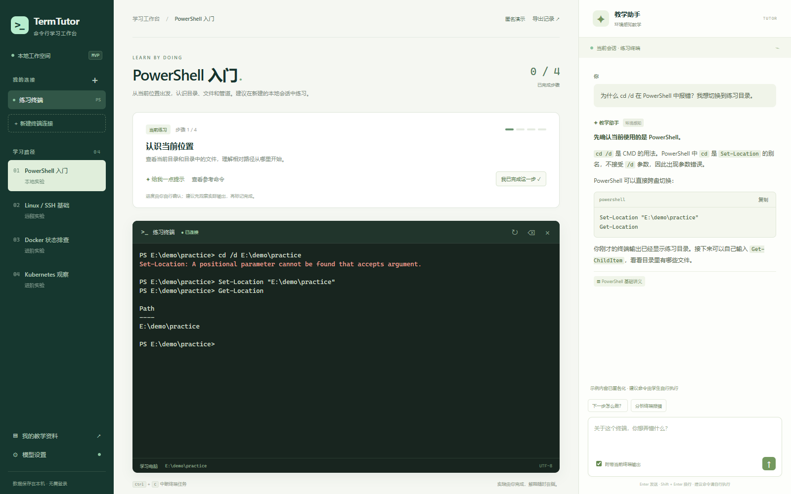

# 计算机命令行教学智能体

面向学生的环境感知型命令行教学助手。产品设计为类似 MobaXterm 的桌面终端：中间由学生操作终端，右侧内置 Pi Agent 教学对话栏。

**现已提供可运行的单机 MVP，位于 [`mvp/`](mvp/README.md)。** 原有 Django 项目仍是框架；MVP 独立实现真实终端、教学助手、本地资料检索和学习记录。Electron/Pi 桌面集成及正式多机部署尚未完成。

## 单机 MVP 体验

在 PowerShell 7 中使用 Conda Python 启动，示例解释器路径按本机安装位置调整：

```powershell
& 'D:\anaconda\envs\py311\python.exe' -m pip install -r mvp/requirements.txt
& 'D:\anaconda\envs\py311\python.exe' mvp/run.py
```

启动后访问 <http://127.0.0.1:8765>。学生在真实 PowerShell 中操作，右侧助手结合当前会话解释命令、分析报错并提供提示；课程进度、对话与资料出处保存在本机。未启用模型时使用明确标注的离线讲义提示。



上图为脱敏演示，终端和回答中的个人信息已替换为示例数据。支持本地会话，另有 SSH/串口连接入口；后两项尚未完成实机验收。使用步骤见 [MVP 使用说明](mvp/README.md)。

## 功能与架构

- 目标场景：Windows PowerShell 7、Linux、Docker、K8s、SSH 与串口 TTY。
- Agent 可以自主探索环境；教学任务中的实际操作由学生输入、执行。
- SSH/串口目标无需安装 AI Agent。串口按实际控制台能力适配，不默认拥有 Linux Shell、独立 exec 或 SFTP。
- 客户端 Pi 管理 Agent 循环；Django 负责账号、课程、知识检索、学习记录与模型网关。
- 模型总上下文设计为 **64k / 65,536 token**，硬件适配与性能尚未实测。

完整 a–e 设计、费用与历史检查均位于 [docs](docs/README.md)。

最新[硬件配置概览](docs/硬件配置概览.md)固定一个 16 GB 控制平面、两个各 16 GB Worker 与独立 64 GB 数据机，共四台 x86 主机；推理区可选原三套 T10 配置及 DGX Spark（双机/四机子配置），整套为 5/6/8 台。数据机为 64 GB、2×2 TB SSD RAID1、4×2 TB HDD RAID10；CPU 嵌入服务部署在数据机，业务 CPU 暂不指定。[四类推理备选](docs/推理服务器备选方案.md)按用户整套价格 8 万/16 万元录入，完整总价与模型适配待确认。该方案尚未部署，不改变下方本地 Django 框架的运行要求。

## 目录结构

```text
.
├── README.md
├── Makefile
├── requirements.txt
├── mvp/                         # 独立可运行单机版，见 mvp/README.md
├── assets/mvp-demo.png           # 脱敏效果图
├── backend/
│   ├── manage.py
│   ├── config/                  # Django Project / 根路由 / ASGI / WSGI
│   ├── apps/
│   │   ├── common/              # 占位响应工具，不单独注册为 APP
│   │   ├── accounts/            # 账号与认证 APP
│   │   ├── courses/             # 课程与实验任务 APP
│   │   ├── knowledge/           # 资料检索 APP
│   │   ├── learning/            # 学习记录 APP
│   │   └── model_gateway/       # 模型网关 APP
│   └── tests/                   # 路由与占位边界检查
├── desktop/                     # 桌面模块目录与职责说明
├── deploy/                      # 后续部署边界说明
└── docs/
    ├── 项目设计方案.md
    ├── 架构设计.md
    ├── 项目设计方案复查报告.md
    └── references/              # 原始需求和白板照片
```

## 环境要求

- Python 3.11，使用 Conda 环境；本项目推荐 `py311`。
- Django 5.2 LTS，版本见 `requirements.txt`。
- Windows 命令示例使用 PowerShell 7。
- GNU Make 是可选命令入口；没有 Make 时使用下方等价命令。

本框架默认使用 SQLite，无需准备 MySQL、GPU、Docker 或 K8s。生产方案中的 MySQL/Qdrant 和模型部署属于后续实现。Electron/Pi 是未来 npm 依赖，不写入 Python 清单，也无需现在安装。

## Django 框架快速开始

以下命令在仓库根目录执行。Windows 使用明确的 Conda 解释器路径：

```powershell
$python = 'D:\anaconda\envs\py311\python.exe'
& $python -m pip install -r requirements.txt
& $python backend/manage.py check
& $python backend/manage.py migrate --noinput
& $python backend/manage.py runserver 127.0.0.1:8000
```

若 Conda 安装位置不同，修改 `$python`。也可以激活自己的 Conda 环境后使用该环境的解释器。Linux 示例同样以已激活的 Conda 环境为前提。

```bash
conda activate py311
python -m pip install -r requirements.txt
python backend/manage.py check
python backend/manage.py migrate --noinput
python backend/manage.py runserver 127.0.0.1:8000
```

启动后访问 [项目入口](http://127.0.0.1:8000/) 或 [健康检查](http://127.0.0.1:8000/api/health/)。Django `runserver` 仅用于本地框架演示。

## Makefile 命令

| 命令 | 作用 |
|---|---|
| `make help` | 显示入口 |
| `make install` | 安装 Python 依赖 |
| `make check` | Django 配置检查 |
| `make migrate` | 创建 Django 自带表 |
| `make run` | 启动本地开发服务器 |
| `make test` | 检查健康、业务占位和路由边界 |

Windows 默认选择上述 py311 路径，并通过 PowerShell 7 执行。可显式覆盖：

```powershell
make check PYTHON="D:/anaconda/envs/py311/python.exe"
make run HOST=127.0.0.1 PORT=8001
```

如果 Windows 安装的是 MinGW GNU Make，可将命令中的 `make` 替换为 `mingw32-make`。

没有 GNU Make 时，检查和测试的等价命令为：

```powershell
& 'D:\anaconda\envs\py311\python.exe' backend/manage.py check
& 'D:\anaconda\envs\py311\python.exe' backend/manage.py test tests --noinput
```

## 路由与占位状态

| 方法与路径 | 当前行为 |
|---|---|
| `GET /` | 项目入口和路由链接，200 |
| `GET /api/health/` | Django 存活检查，200；不代表模型、数据库依赖或目标主机可用 |
| `POST /api/auth/login/` | 账号认证占位，501 |
| `GET /api/courses/` | 课程列表占位，501 |
| `GET /api/courses/<course_id>/tasks/` | 实验任务占位，501 |
| `POST /api/knowledge/search/` | 课程 RAG 占位，501 |
| `POST /api/learning/conversations/` | 教学记录占位，501 |
| `POST /api/learning/events/` | 学习事件同步占位，501 |
| `POST /api/model/chat/` | 模型流式网关占位，501 |
| `/admin/` | Django 自带管理入口；没有预置账号或业务模型 |

业务占位统一返回 `error.code = NOT_IMPLEMENTED`，不生成虚构的模型回答、课程记录或探索结果。POST 保留 Django 的 CSRF 中间件；没有 CSRF 凭证的普通客户端可能先收到 403，这不表示业务已经实现。文档中的 API 均采用尾部 `/`。

`models.py` 目前仅说明未来职责，数据库设计见方案文档。执行 `migrate` 只创建 Django 自带表，不宣称已经落实所有领域模型。

## 配置与边界

- `DJANGO_DEBUG`：开发默认 `1`。
- `DJANGO_SECRET_KEY`：开发有显式占位默认值；`DEBUG=0` 时必须提供独立值。
- `DJANGO_ALLOWED_HOSTS`：逗号分隔，默认仅本机。
- `MODEL_CONTEXT_WINDOW` 等窗口常量保存在 Django settings，仅表达设计约束，不会自动启动模型或保证硬件容量。

禁止将 SSH 私钥、口令、令牌、数据库文件或实际终端日志提交到仓库。框架不提供服务器端任意 Shell 执行接口。后续实现应将工具绑定到客户端管理的会话。

## Git 提交与托管

本地仓库可正常审阅和提交。GitHub/Gitee 远端地址需由项目持有人选择，本框架不填入虚构仓库 URL。发布到已创建的空仓库时：

```powershell
git remote add origin <实际仓库地址>
git push -u origin main
```

`<实际仓库地址>` 必须替换为自己的目标仓库，以上为说明，不会由应用自动执行。
