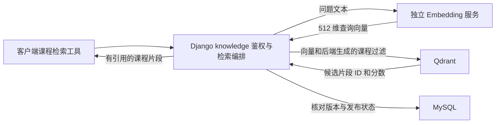

# Embedding 职责与流程

本项目将 Embedding 归入知识库/RAG 子系统，区分业务编排、向量计算、向量数据库和物理部署位置。当前只完成设计，未接通实际服务。

## 组件职责

| 组件 | 职责 | 规划部署 |
|---|---|---|
| Django `knowledge` 模块 | 用户和课程鉴权、资料版本、入库任务编排、检索过滤、结果与引用组织 | 两个各 8 GB Worker 上的 Django |
| 后台入库任务进程 | 文本提取、清洗、切片，调用嵌入服务，写入向量与元数据，反馈任务状态 | 32 GB 数据服务器，异步、限制并发 |
| 独立 Embedding 服务 | 加载 BGE 模型，将输入文本转换为 512 维向量，批量或单条返回 | 数据服务器的独立 CPU 进程或容器 |
| Qdrant | 保存向量、过滤元数据和索引，执行向量相似度检索 | 数据服务器 |
| MySQL 与资料服务 | 保存业务元数据、片段文本、资料版本与原文 | 数据服务器，按 SSD/HDD 分工保存 |
| 大模型推理服务 | 根据问题、环境证据和检索片段生成教学回答与工具请求 | 独立推理区，四类硬件备选 |

Embedding 服务化是可采用的部署方式，例如 Hugging Face TEI 专门提供嵌入模型的部署和推理服务；本项目不限定必须采用 TEI，具体引擎与 CPU 兼容性后续验证。[TEI 官方说明](https://huggingface.co/docs/text-embeddings-inference/index)

## 资料入库

教师提交资料 → Django 鉴权并登记课程与版本 → 后台任务读取原文、清洗和切片 → 调用 Embedding 服务生成片段向量 → 写入 Qdrant 与 MySQL 元数据 → 核对引用、权限与版本 → 按审核流程发布。

批量计算在后台执行，不在 Django Web 请求内加载模型或等待整批资料处理。后台任务属于知识库流程；把执行进程放在数据服务器，不意味着将业务权限判断交给数据库。

## 在线检索

客户端 Pi 再把检索片段与终端证据提供给大模型，继续原有教学工具循环。课程权限与发布状态由 Django 根据身份确定，不接受客户端或模型自行扩大检索范围。文本入库和查询使用同一嵌入模型版本、512 维向量及一致的处理规则；更换模型后重新构建并切换索引。[BGE 模型卡](https://huggingface.co/BAAI/bge-small-zh-v1.5)

## 本项目的部署取舍

将嵌入服务与后台入库进程放在 32 GB 数据机，是针对当前三个 K8s 节点各 8 GB 的小班试点安排。MySQL、Qdrant、嵌入和后台任务分别配置资源及运行身份，进程/容器之间通过内网接口调用；嵌入接口不直接对学生客户端开放。

初始仅一个后台入库任务并发，在线查询优先，批量入库与备份、索引重建错峰。嵌入及入库先按 4 GB 预算，实际并发、线程数、批量大小和内存上限在测量后确定。数据机内存分配见[项目设计方案](项目设计方案.md) d3。

后期当批量任务影响数据库或在线检索时，可把这个独立服务和任务进程迁到专用 CPU/GPU 节点；逻辑接口不需要随物理位置变化而重写。
