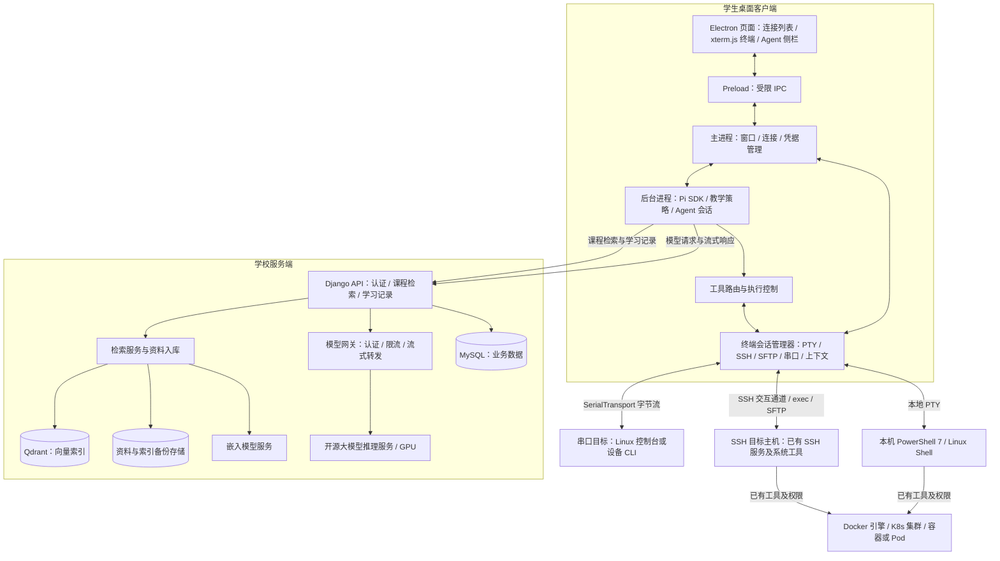

# 环境感知型命令行教学助手——框架架构设计

设计日期：2026-10-31。

> 本文件保留模块与架构细节。a–e 的统一设计基线、具体节点与费用见[项目设计方案.md](项目设计方案.md)，复查见[项目设计方案复查报告.md](项目设计方案复查报告.md)。

## 1. 项目定位与本次范围

面向计算机课程学生，提供类似 MobaXterm 的桌面终端客户端：左侧管理连接，中间为真实终端，右侧为内置教学 Agent 对话栏。交互参考 Clide，Agent 运行时采用客户端嵌入 Pi SDK 的设计。

支持 Windows PowerShell 7、Linux Shell、Docker、Kubernetes（K8s）、SSH 远程操作与串口 TTY 文本控制台。Linux 首批以 Bash 为设计基线，串口按 Linux 控制台或已知设备 CLI 分别适配。

Agent 可以为了解环境、调查问题和验证判断主动执行探索；学生练习和实际操作由学生输入、执行。SSH 目标机器不需要安装 AI Agent、常驻采集器或模型运行环境。

**本文件描述架构、模块划分、数据与接口契约、部署思路。** 当前已建立最小 Django 与本地 Git 框架；桌面端、Pi、SSH、串口、RAG 和模型服务仍为设计，未连接实际目标。已实现范围以[仓库 README](../README.md)及[框架验收](仓库框架验收.md)为准。

## 2. 总体架构



图中模型网关是 Django 后端中的逻辑模块，初版无需单独建设网关微服务。资料检索也是后端模块，避免为框架作业引入过多组件。

**职责边界：Pi 在客户端维护 Agent 循环；Django 不重复维护同一轮 Agent 的工具调度状态；终端到目标主机的交互数据不经过 Django 转发。**

上述是本项目的设计组合，并非 Pi 或 Electron 默认提供的完整成品。Pi 的 SDK、自定义工具与事件机制可支持这一接入方向。[Pi SDK](https://pi.dev/docs/latest/sdk)、[远端工具扩展](https://pi.dev/docs/latest/extensions#remote-execution)

## 3. 桌面客户端模块

| 模块 | 主要职责 | 边界 |
|---|---|---|
| 连接管理 | 本地/SSH/串口配置、连接与断开、多终端标签 | 连接及登录凭据留在本机，不进入模型上下文 |
| 终端视图 | 展示真实终端，转发学生键盘输入和窗口尺寸变化 | 教学建议不自动写入终端 |
| Agent 侧栏 | 对话、流式回复、探索活动、资料引用、停止按钮 | 每次运行明确绑定目标会话 |
| Pi 运行时 | 模型调用、工具选择、结果回流、上下文压缩与会话恢复 | 替换默认本地工具，使用本项目的受控工具集 |
| 上下文管理 | 当前目录、Shell、主机、容器与集群目标、近期输出 | 记录来源、时间及已知/推断/未知状态 |
| 工具执行层 | 探索路由、参数验证、超时、取消、结果裁剪 | 不根据模型自称“探索”就放行任意操作 |
| 会话管理器 | 本地 PTY、SSH 交互通道、exec、SFTP 与 SerialTransport | 按连接能力路由，串口单通道串行使用 |
| 本地数据管理 | 连接配置、Pi 会话、暂存的学习事件 | 服务端只同步选定的教学记录，避免双端会话冲突 |

页面进程负责显示，主进程负责连接和系统能力，Pi 放入后台运行进程，防止探索任务阻塞界面。通过受限 IPC 通信，不向页面暴露任意系统调用接口。Electron 的多进程机制可作为划分基础。[Electron 进程模型](https://www.electronjs.org/docs/latest/tutorial/process-model)

Pi 初版选用 `pi-coding-agent` SDK，复用会话与生命周期能力；SSH 连接、终端捕获和执行控制由本项目设计。具体 SDK 版本在未来实施时锁定，本次不编写依赖锁文件。

模型总上下文按最新要求统一为 64k（65,536 token）。Pi、Django 网关与模型服务使用同一上限；输入 60,000、生成 4,096、余量 1,440 token。预计输入达到 56,000 时压缩旧历史，目标约 48,000，保留目标和证据关联。模型超时初始设 600 秒、运行上限 1800 秒，均为待长输入验证校准的设计值，不承诺现有 GPU 已达标。完整规则及容量估算见正式方案 d2/e2。

## 4. Agent 如何适应不同环境

### 4.1 先知道有哪些能力，再按需探索

每个连接提供能力描述，例如：可读终端输出、可运行 Bash、可读远端文件、Docker CLI 可用、K8s 访问尚未验证。Agent 据此选择探索工具，不能因为工具名存在就假定连接成功或权限足够。

流程为：学生问题 → 获取当前会话证据 → 判断还缺什么 → 调用探索工具 → 读取结果 → 更新判断 → 继续探索或给出讲解。

| 设计工具 | 作用 |
|---|---|
| `get_session_context` | 读取指定会话的环境摘要与能力 |
| `read_terminal_output` | 读取指定范围内的终端输出 |
| `explore_command` | 在已绑定目标中执行探索命令 |
| `list_files` / `read_file` | 获取限定目录或文件内容 |
| `search_course_materials` | 向 Django 请求课程知识检索 |
| `present_guidance` | 发布讲解、资料引用和学生操作建议，不写入终端 |
| `list_serial_ports` / `get_serial_settings` | 枚举串口并读取端口配置，不自动打开未知设备或扫描参数 |

工具名称为本项目设计。Docker/K8s 初版通过目标环境已有 CLI 及受控探索覆盖，不另建庞大的专用运维工具体系；未来可加入 API 适配器。

### 4.2 会话上下文模型

| 字段 | 含义 |
|---|---|
| `connection_id` | 本地、SSH 或串口的一次连接标识 |
| `transport` / `capabilities` | local/ssh/serial 及当前可用工具能力；不向串口默认开放 exec 或 SFTP |
| `terminal_id` | 学生交互终端标识 |
| `environment_id` / `parent_environment_id` | 当前环境及其父环境，例如主机与容器 |
| `context_revision` | 上下文版本，防止切换环境后使用旧目标 |
| `os` / `shell` / `cwd` / `identity` | 系统、Shell、目录和用户身份 |
| `selected_env` | PATH、虚拟环境标识等经过筛选的信息 |
| `docker_target` | Docker context、引擎目标及已知容器标识 |
| `k8s_target` | context、cluster、namespace、Pod/容器标识及身份引用 |
| `observed_at` / `source` / `status` | 采集时间、来源及 verified/inferred/unknown 状态 |
| `serial_settings` / `console_kind` | 串口路径、通信/编码/换行参数，以及 Linux/设备 CLI/Bootloader/unknown 类型 |

这些字段不是登录后必然全部可得。通过终端事件与探索逐步补齐；不能把推断和实时事实混在一起，也不能把本机终端位置等同于 Docker/K8s 实际目标。

运行开始后固定绑定环境与上下文版本。切换界面标签不会让正在执行的请求自动改投另一台主机；SSH 重连、容器退出等使原绑定失效时，暂停原运行并重新核实目标。

## 5. 无远端 Agent 的 SSH 探索

客户端建立标准 SSH 连接，自行管理终端输出和命令结果。远端仅执行已有 Shell 和探查工具，不要求安装 Pi、Python 采集器或 AI 服务。标准 SSH 支持远端登录 Shell 和远端命令执行。[OpenSSH 说明](https://man.openbsd.org/ssh)

| 通道 | 用途 | 状态与限制 |
|---|---|---|
| 学生交互 PTY | 学生操作及必须依赖当前 Shell 的探测 | 受当前目录、激活环境、Shell 函数等影响；需要协调学生输入和前台任务 |
| 独立 SSH exec | 进程、文件、日志等不依赖交互状态的探查 | 不自动继承交互 Shell 的目录、变量、别名和虚拟环境 |
| SFTP | 远端文件浏览与读取 | 不使用 SFTP 自身目录冒充交互 Shell 当前目录 |

优先将不依赖当前 Shell 的探查放到独立 exec。必须核实当前会话状态时，仅在交互终端空闲且处于 Shell 提示符时串行执行探测，并显示活动。学生正在输入、输入密码或运行 vim、top 等前台程序时，不插入探测命令；若无法可靠判断，则等待，不猜测终端可用。

需要精准捕获目录等状态时，可在本次会话内做临时探测或加载会话级 Shell 集成；不要求修改远端启动配置或安装常驻组件。机制不可用时标为未知，不承诺任意 SSH、多层跳转和交互程序均可无损感知。

容器与 Pod 的内部探索通过目标主机可用的 `docker exec` / `kubectl exec` 或已接入内部终端路由，并受权限与内部工具可用性限制。进入 `sh` 不代表一定存在 Bash；无法进入时只能分析外部状态。

### 5.1 串口 TTY 接入

客户端后台采用 Node SerialPort 适配 Windows COM 和 Linux 串口路径。串口配置包含波特率、数据位、校验、停止位、流控、编码、换行及设备命令规则。端口接入使用现有教学设备和匹配线缆，设备端不运行 Agent。

串口只有共享字节流，没有独立 SSH exec 或 SFTP。状态机区分观察、登录、可输入、学生占用、Agent 探索和未知；仅在已识别控制台的空闲提示符处取得短时写入权探查，不能向登录提示、前台程序或持续启动日志盲目发送命令。

发送成功不等于执行完成，不假定有退出码或 stdout/stderr 分离。无法确认完成时返回 unknown；取消默认停止后续发送，不自动发 Ctrl+C/BREAK、切换控制线或复位设备。拔插和参数变化使旧上下文失效，端口同名不视为同一设备。完整规则见正式方案 d4。

串口的 `read_file` 能力仅在控制台及读取方式可验证时开放，不静默改投本机或独立 SSH。SerialPort/Electron 原生模块、驱动与端口权限作为后续兼容性验证项。[接口说明](https://serialport.io/docs/api-stream/)、[Electron 接入](https://serialport.io/docs/guide-electron/)

## 6. 教学与探索的分工

Agent 自主探查问题相关的状态、日志与配置，必要时在隔离环境做验证；操作建议由学生执行。安装软件、修改作业文件、变更容器/集群和重启服务等实际教学环境操作不自动代做。

同一条命令能否由 Agent 执行，需要结合教学目标：若练习本身就是查看目录，助手应先给提示；若查看目录是排查另一个问题所需的证据，可以作为探索。

执行控制采用受限权限、参数与目标校验、时长和输出限制、审计以及可取消执行。命令名称白名单或模型分类均不能保证任意 Shell 组合绝对无副作用；设计应承认这一限制，优先使用结构化读取，复杂验证放入隔离环境。终端输出、文件和日志只作为证据，不作为新的操作授权。

停止按钮应向 Pi 和具体执行适配器传递取消；仅停止模型流不能代表远端进程已经退出。结果应记录完成、失败、超时、取消或状态未知。

## 7. Django 后端与模型服务

| Django APP | 职责 |
|---|---|
| `accounts` | 用户认证、学生/教师角色及课程访问权限 |
| `courses` | 课程、实验任务与教学目标 |
| `knowledge` | 资料元数据、切分索引、检索与来源引用 |
| `learning` | 教学对话摘要、探索事件和学生反馈 |
| `model_gateway` | 模型请求认证、限流、流式转发和用量记录 |

Pi 通过模型适配器调用 Django 的模型网关，再连接学校部署的开源模型。网关必须保留文本流、工具定义、工具调用参数、结束状态和错误信息；后端不执行模型返回的工具调用，工具调用回到客户端 Pi 处理。

模型选型的验收条件包括中文教学解释、工具调用格式、连续多步探索和客户端协议兼容性。现有需求整理中的具体模型名称、量化与硬件适配仍需另行核实，本架构不据其名称宣称已经可部署。

RAG 用于检索课程知识、命令手册和案例；环境事实由终端与探索提供。教师授权资料入库，附课程、版本和来源。资料切分后由嵌入模型生成向量并存入 Qdrant，原文与 MySQL 元数据关联。查询时先做课程权限过滤，再返回相关片段与出处。

初版资料入库设计为管理命令/人工触发，不额外引入消息队列。Qdrant 是本方案的向量库选型建议，开发演示可使用单实例。

## 8. 接口与事件契约

### 8.1 桌面内部契约

- 对话输入：`conversation_id`、`terminal_id`、学生问题。
- 探索请求：`run_id`、`request_id`、环境标识、上下文版本、命令、执行方式、时限、探索目的。
- 探索结果：对应请求标识、实际目标、通道、输出、退出状态、时间、裁剪标识及错误。
- 侧栏事件：文本增量、工具开始、工具输出、工具结束、教学建议、运行完成/中断。
- 事件必须携带运行和会话标识，页面不能将后台旧会话输出显示为新会话的探索结果。

### 8.2 服务端接口草案

| 接口 | 用途 |
|---|---|
| `POST /api/auth/login` | 登录并获取应用访问凭证 |
| `GET /api/courses` | 获取可访问课程 |
| `GET /api/courses/{id}/tasks` | 获取实验任务 |
| `POST /api/knowledge/search` | 按课程和问题检索资料 |
| `POST /api/learning/conversations` | 建立教学记录关联 |
| `POST /api/learning/events` | 同步经过筛选的学习与探索事件 |
| `POST /api/model/chat` | 客户端 Pi 模型适配器使用的流式网关契约 |
| `GET /api/health` | 服务健康状态 |

这些是模块边界草案，不是完整 HTTP 规范。模型网关的具体协议在实施时与所锁定 Pi 版本及推理服务一起确定；不能仅凭接口名假定现有模型协议完全兼容。

## 9. 数据设计

服务端使用 MySQL 保存业务数据，Qdrant 保存向量索引，文件存储保存原始教学资料。SQLite 可作为 Django 本地演示替代。学生连接配置与 SSH 凭据不进入服务端业务库。

| 表 | 主要字段 | 关系 |
|---|---|---|
| `users` | id、username、role、created_at | 使用 Django 用户体系 |
| `courses` | id、name、owner_id、description | owner 关联教师 |
| `enrollments` | id、user_id、course_id、role | 用户与课程多对多，组合唯一 |
| `lab_tasks` | id、course_id、title、objective、guidance_policy | 一门课程多个任务 |
| `knowledge_documents` | id、course_id、title、source_uri、version、status | 文档归属课程 |
| `knowledge_chunks` | id、document_id、ordinal、text、vector_id | 片段关联文档及向量点 |
| `learning_conversations` | id、user_id、task_id、client_session_id、summary、created_at | 一次教学对话；task 可空 |
| `learning_events` | id、conversation_id、client_event_id、kind、target_summary、payload、occurred_at | 事件按 client_event_id 幂等同步 |
| `feedback` | id、conversation_id、rating、comment | 学生反馈 |

Pi 本地会话是运行上下文的权威来源；MySQL 保存教学摘要与选定事件，框架阶段不做跨设备恢复同一运行。原始终端输出保留在本地有限缓冲区，按问题选取并脱敏后才进入模型；模型代理不额外持久化完整原始提示。

## 10. 一次完整交互

以“SSH 登录后，学生询问容器为何退出”为例：

1. 学生在桌面端连接服务器，SSH 管理器建立交互终端；客户端登记会话和已知环境。
2. 学生在右侧提问，创建绑定该会话的 Pi 运行，附当前任务、必要输出和环境证据。
3. Pi 调用模型网关；模型提出状态与日志探查工具调用。
4. 执行控制层核实目标和探索范围，选择 SSH exec 或协调后的交互通道执行。
5. 结果返回 Pi，模型继续分析；需要解释概念时调用课程检索工具。
6. 侧栏展示证据、资料出处、原因解释与建议命令，实际修复由学生操作。
7. 学生执行后的输出成为新证据；后续对话继续分析，并同步必要学习记录。

整个过程中，SSH 密码与私钥由桌面连接层处理，不作为模型工具参数或请求内容上传。

## 11. 部署与运维框架

- **学生端**：Windows/Linux 桌面安装包，内含应用与 Pi SDK；无需学生端 GPU或外部 Agent CLI。
- **学校业务侧**：一个 32 GB DDR3 控制平面、两个各 16 GB DDR3 Worker；部署 Django、教学 API、CPU 嵌入与资料处理。
- **学校数据侧**：独立 32 GB 数据服务器，2 TB SSD 存 MySQL 与 Qdrant 在线数据，4×2 TB HDD RAID10 存教学原始资料、归档与本机备份，约 4 TB 可用。
- **学校模型侧**：独立推理区三选一：原 GPU 单机（64 GB RAM）、双机或四机 DGX Spark（每台 128 GB 统一内存）；Spark 配 DeepSeek-V4.1-Flash-1017，用户整套价格为 8 万/16 万元，适配待验证。不计入两个 16 GB Worker。
- **被教学/操作目标**：已有 Linux/Windows SSH 主机、Docker 引擎与 K8s 集群；不是学校模型服务的必要组成。
- **串口工位**：既有教学设备接学生电脑，试点规划 4 套匹配设备的串口适配器/线缆；预算已并入正式方案 e 节。

课堂部署固定四台 x86 业务/数据主机，按推理方案整套共 5/6/8 台；Spark 是 Arm 平台，经模型 API 对接。K8s 由一个控制平面与两个业务 Worker 组成，数据服务和模型推理分别独立部署。业务 CPU、主板和磁盘具体型号暂不指定；DDR3 兼容性在具体平台选定后确认。Spark 高速互连单独规划，不复用普通千兆业务网络来保证模型并行。当前配置见[硬件配置概览](硬件配置概览.md)与[推理服务器备选方案](推理服务器备选方案.md)，框架阶段不实际创建集群。

RAID10 的四块 2 TB HDD 裸容量为 8 TB，可用约 4 TB；不把它写成单组 RAID1。机内 RAID 不替代独立离线备份，单块 SSD 也未获得 HDD 阵列的磁盘冗余。备份容量与保留周期按正式方案 d6 校验。

运维设计覆盖 API/模型错误率与延迟、GPU 容量、检索失败、客户端版本、数据库与资料备份、索引重建以及模型版本回退。SSH 探索失败由客户端显示，不与学校模型服务故障混为同一状态。

模型不可用时保留正常终端；SSH 断开时终止或标记相关探索未知；课程检索不可用时说明资料缺失，不能生成虚假引用。

硬件与费用另列设计章节：区分 GPU 推理服务器、业务与数据服务、存储备份、网络和运维成本。现有三套报价可作为待核验输入，不能直接当作完整 K8s 集群费用；本次不采购、不安装、不进行性能承诺。

## 12. 建议仓库结构与框架交付

以下为当前框架目录；桌面端仅保留模块目录，部署目录仅说明边界：

```text
project/
├── README.md
├── Makefile
├── requirements.txt
├── docs/
│   ├── README.md
│   ├── 项目设计方案.md       # a–e、接口、数据、部署和费用
│   ├── 架构设计.md
│   ├── 仓库框架验收.md
│   └── references/          # 原始需求及白板照片
├── desktop/
│   ├── src/main/          # 窗口、连接与凭据管理
│   ├── src/preload/       # IPC 契约
│   ├── src/renderer/      # 连接列表、终端与右侧 Agent
│   ├── src/agent/         # Pi 会话、教学策略、事件
│   ├── src/tools/         # 上下文、探索、文件、课程检索
│   ├── src/sessions/      # 本地 PTY、SSH、SFTP、SerialTransport 与状态
│   └── src/contracts/     # 事件、工具与环境上下文类型
├── backend/
│   ├── manage.py
│   ├── config/            # Django Project
│   └── apps/              # accounts/courses/knowledge/learning/model_gateway
└── deploy/                # 部署拓扑说明与未来配置位置
```

设计验收以文档能回答下列问题为准：Agent 在哪里运行、终端命令在哪里执行、如何识别当前环境、SSH 如何免安装接入、探索与练习如何分工、RAG 与实时状态如何结合、数据保存在哪里、故障如何反馈。

当前已交付课程要求的本地 Git 框架：Django Project、五个 APP、占位 views/urls、README、Makefile 和依赖清单。业务接口明确返回未实现；Pi、SSH、串口、RAG、领域数据库与生产部署未接通，也未发布到远端托管平台。

## 13. 参考依据

- [原始需求整理](需求整理.md)
- [同类项目调研](同类项目调研.md)
- [Clide：交互与终端工具参考](https://github.com/DLbury/clide)
- [Pi SDK](https://pi.dev/docs/latest/sdk)
- [Pi 自定义与远端工具](https://pi.dev/docs/latest/extensions#remote-execution)
- [Electron 进程模型](https://www.electronjs.org/docs/latest/tutorial/process-model)
- [OpenSSH](https://man.openbsd.org/ssh)
