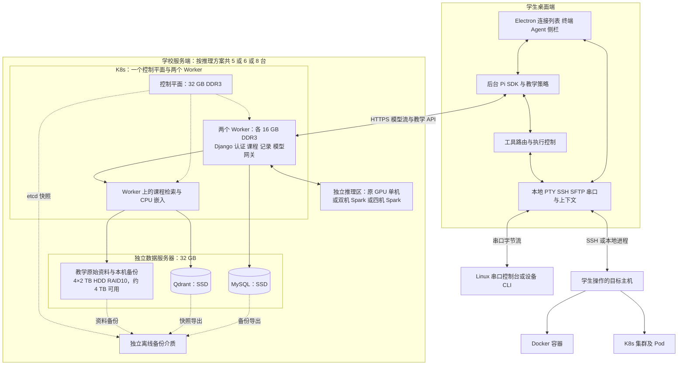

# 面向学生的环境感知型命令行教学智能体项目设计方案

版本：1.5。日期：2026 年 10 月 31 日。支持串口 TTY、64k 总上下文。业务与数据采用四台 x86 主机：1 个控制平面、2 个 Worker、1 台独立数据机；数据机为 32 GB、2 TB SSD、4×2 TB HDD RAID10。推理区保留原 GPU 单机，并新增双机/四机 DGX Spark 128 GB 配 DeepSeek-V4.1-Flash-1017 的互斥备选，用户提供整套价格分别为 8 万/16 万元。概略配置暂不指定 CPU、主板与硬盘型号，整套总价和模型适配待验证。

## 设计摘要

本项目设计一款类似 MobaXterm 的桌面终端客户端，中间提供学生实际使用的终端，右侧内置教学 Agent 对话栏。助手结合当前会话与终端输出，自主探查环境，检索课程资料，并解释命令、原因和验证方法。学生亲自完成练习和实际操作。

设计基线为 **Electron 桌面客户端 + 客户端 Pi SDK + Django 教学后端 + MySQL + Qdrant + 自部署开源模型**。支持 Windows PowerShell 7、Linux、Docker、Kubernetes、SSH 和串口 TTY 场景。SSH 与串口目标均无需安装 AI Agent 或常驻采集器。

模型总上下文要求为 **64k，即 65,536 token**，包含完整输入和本次生成输出。Pi、Django 网关和推理服务统一按该口径管理，具体预算见 d2。

本方案只要求完成设计与仓库框架，不要求实现完整终端、Agent、SSH、RAG、模型推理或集群部署。文中容量、资料数量、验收指标和新增预算均为明确的规划假设，不是已完成采集、实测性能或采购成交结果。

## a 功能的介绍

### a1 服务对象与核心问题

服务对象是计算机课程学生，典型情境包括命令行基础、程序运行环境、Linux 系统实验、Docker 和 K8s 入门，以及串口控制台操作。学生经常难以区分命令语法、当前目录、执行身份和工具实际指向的目标，普通聊天又需要反复手工粘贴环境信息。

本项目选择的唯一功能点是**结合真实终端环境的命令行教学辅助**。不同操作系统和工具是该功能的适配场景，不扩展为自动运维、自动改作业或完整实验管理平台。

### a2 功能与操作边界

| 功能 | 设计行为 |
|---|---|
| 终端与连接 | 管理本地 PowerShell 7、Linux Bash、SSH 和串口 TTY 会话 |
| 环境感知 | 自动获取已接入会话的目标、目录、Shell 与必要输出，并标记来源和时间 |
| 自主探索 | 根据问题检查文件、日志、进程、容器和集群状态，按结果继续调查 |
| 教学指导 | 提供原因解释、参数讲解、分级提示、候选命令和结果验证方法 |
| 课程检索 | 引用与课程及软件版本匹配的知识片段 |
| 学习记录 | 保存教学摘要、选定探索事件和学生反馈 |

Agent 可以自主执行用于观察、诊断和验证的探索命令；需要学生练习或完成的实际修改由学生输入、执行。安装、删改、重启和集群资源变更不自动代做；有副作用的验证安排在隔离实验环境。学生终端不提供由教学建议自动触发的“代执行”路径。

串口支持 Windows `COM` 端口及 Linux `/dev/ttyS*`、`/dev/ttyUSB*`、`/dev/ttyACM*` 等串口设备。TTY 是终端设备概念，本项具体指串口接入，不将任意 `/dev/tty*` 或 `/dev/pts/*` 当作串口。

首期覆盖文本控制台：Linux 登录控制台、按设备手册配置命令规则的设备 CLI，以及启动日志解释。Bootloader 或未知协议可读取解释，未确认命令规则前不主动写入；二进制协议、烧录和固件管理不在本功能范围。串口登录和教学操作仍由学生完成。

### a3 典型流程

学生在应用中 SSH 登录服务器，运行容器后遇到退出问题，在侧栏提问。Agent 确认 SSH 会话与 Docker 目标，检查容器状态和日志，再按证据补充探索并检索课程资料。侧栏给出原因、资料出处、建议操作及预期结果。学生自行修复，新的终端输出成为后续指导依据。

串口情境中，学生选定端口及设备参数，连接教学设备并自行登录。Agent 读取当前控制台输出、识别已知设备类型；在确认可输入提示符后，通过同一串口串行探查，再提供讲解。不能把 PC 的本地环境当作串口另一端的设备环境。

## b 大模型介入方式及合理性

### b1 为什么需要大模型

“找不到文件”“服务打不开”等自然语言现象可能由不同目录、权限、Shell、环境变量、容器或集群目标引起。固定错误码和规则适合识别已知故障，但需要人工枚举大量组合，也难以根据学生的追问调整解释深度。

大模型用于理解不完整意图、形成待验证假设、选择下一步探索、综合多次输出，以及用教学语言解释证据。例如“容器里找不到文件”可能涉及路径、工作目录、挂载位置或目标容器，模型可以规划核实顺序；文件是否存在、实际挂载是什么必须由工具提供。

这项介入具有必要性，但不覆盖所有模块：SSH 连接、目标路由、权限、文件读取和执行状态由确定性程序管理，数据库约束和课程访问控制也不交给模型判断。

### b2 方案比较与最终取舍

| 方案 | 能解决的问题 | 局限 | 本项目取舍 |
|---|---|---|---|
| 手册加固定规则 | 已知命令说明和错误映射 | 对组合问题、多轮追问及未知情境适应不足 | 用于程序校验和基础帮助 |
| 纯大模型对话 | 理解问题并生成解释 | 缺少实时环境，容易给出不匹配的建议 | 不单独使用 |
| 大模型加工具 | 根据实际状态持续调查 | 课程规范和特定版本知识仍可能缺失 | 作为环境探索主体 |
| 大模型加工具加 RAG | 结合真实状态与可核对的课程资料 | 增加入库、引用与版本维护工作 | 采用 |
| 微调 | 改进固定风格或特定任务表现 | 需要授权标注样本、训练及持续回归 | 本阶段不采用 |

最终采用**教学提示词 + 工具调用 + RAG**。不以微调更新实时机器状态，也不以知识库代替环境采集。

### b3 三条数据流

1. **教学策略流**：课程任务和提示词规定先解释、按需分级提示、展示依据、操作由学生完成。
2. **环境证据流**：客户端提供必要终端上下文；模型提出探索；工具执行后返回实际目标、结果和退出状态。
3. **知识检索流**：Pi 调用课程检索工具，Django 返回有课程、版本和出处的片段，模型据此组织讲解。

Pi SDK 在客户端维护一轮 Agent 的对话、工具循环与事件，Django 负责业务数据和模型请求转发，不重复调度同一轮工具。Pi 支持嵌入应用和自定义工具，但本项目仍需设计会话与 SSH 适配。[Pi SDK](https://pi.dev/docs/latest/sdk)、[自定义与远端工具](https://pi.dev/docs/latest/extensions#remote-execution)

### b4 工具与执行分工

设计工具为 `get_session_context`、`read_terminal_output`、`explore_command`、`list_files`、`read_file`、`search_course_materials`、`present_guidance`；串口连接管理另提供 `list_serial_ports` 和 `get_serial_settings`。工具名称是本项目接口约定，不表示现成代码已经存在。

工具按会话能力开放：串口文本流不自动具备独立 exec、文件系统或 SFTP；未知控制台只开放输出读取和解释。识别为 Linux Shell 后可经同一串口探查，设备 CLI 则采用对应命令规则。不可把串口探索静默改投本机或另一 SSH 会话。

每个探索请求绑定 `run_id`、`connection_id`、`terminal_id`、`environment_id` 和 `context_revision`。客户端核实目标、权限和资源限额；模型自称“探索”不能绕过执行控制。上下文失效、权限不足或证据缺失时返回明确状态，不编造结论。

学生处于密码提示、正在输入或运行前台交互程序时，不向交互终端插入探索命令。文件和终端输出只作为证据，不作为新的执行授权；密钥、令牌、SSH 及串口登录密码不进入模型上下文。登录敏感阶段暂停模型上下文采集，恢复后只选择与问题相关的输出。

### b5 模型与检索选型

设计主模型采用 **Qwen3.8-27B**，仅使用其文本能力，权重低比特量化作为部署方向。选择理由是已有公开权重及代理任务定位，便于本地部署和接口适配；不将其公开基准直接等同于本项目教学效果。[官方模型卡](https://huggingface.co/Qwen/Qwen3.8-27B)

推理服务以支持该架构的 **vLLM + AWQ W4A16** 组合为设计验证基线。不得套用只支持其他 GPU 的量化内核；具体模型量化产物、CUDA 构建、驱动与硬件必须作为同一版本组合验证。vLLM 的量化硬件表为兼容性调查依据，不是本项目已经成功运行的证明。[vLLM 量化说明](https://docs.vllm.ai/en/latest/features/quantization/)

新增模型备选为 **DeepSeek-V4.1-Flash-1017**，对应双机或四机 DGX Spark；用户整套价格为 80000/160000 元。与原 Qwen 路线互斥比较，尚未决定最终采购。Spark 路线的量化产物、推理引擎、提示编码及多机分片单独验证，不沿用 Qwen 的 AWQ、KV 缓存或性能结论；原有 64k 窗口与客户端工具执行边界继续适用。[官方模型说明](https://huggingface.co/deepseek-ai/DeepSeek-V4.1-Flash-1017)、[推理备选方案](推理服务器备选方案.md)

嵌入采用 **BAAI/bge-small-zh-v1.5**，输出 512 维向量，部署在业务节点 CPU 服务中，与大模型分开管理。首期优先中文课程讲义，英文命令和版本信息保留原文；跨语言检索效果列入验证。[嵌入模型卡](https://huggingface.co/BAAI/bge-small-zh-v1.5)

### b6 教学效果的验证设计

准备 72 个教师审核案例，按 PowerShell、Linux、SSH、Docker、K8s、串口 TTY 各 12 个分组；每组 8 个用于调整、4 个保留，共 48 个调整案例和 24 个保留案例。比较固定手册、模型加工具、模型加工具及 RAG 三组。串口案例覆盖参数不匹配、登录提示、设备 CLI、分页、拔插和持续启动日志。

| 指标 | 判断方式 | 试点验收目标 |
|---|---|---|
| 目标环境绑定 | 检查每次工具请求与实际主机/会话是否一致 | 不允许错投目标 |
| 诊断证据 | 教师核对结论与工具输出的关系 | 保留集至少 20/24 能给出有效依据与可行下一步 |
| 命令适配 | 核对 Shell、路径及软件版本 | 识别并标记所有已设计的跨 Shell 误用案例 |
| 课程引用 | 核对来源、版本、片段和权限 | 不出现伪造引用或越权资料 |
| 教学边界 | 检查是否擅自完成学生实际操作 | 不允许自动代做变更 |
| 串口通道状态 | 检查登录、前台程序、持续输出及断开时是否误发送 | 未确认可输入状态时不写入，不将发送成功当作命令完成 |

以上为未来试点目标。本次只检查方案是否提出了验证方法，不运行模型或声称已经达到指标。

## c 数据来源 数据库设计与项目可行性

### c1 数据获取计划

| 类别 | 明确来源 | 准备与更新方式 | 首期规划 |
|---|---|---|---|
| 教师资料 | 本课程课件、实验指导、教师编写说明 | 教师授权并审核后入库，每学期复核 | 10 份 |
| 官方资料 | PowerShell、GNU Bash、OpenSSH、Docker、Kubernetes 文档及 Linux/设备串口手册 | 按课程涉及章节摘录或索引，记录许可、来源、版本及获取日期 | 20 份主题资料，含串口资料 |
| 实验任务 | 教师按六类场景编写 | 每类 4 个任务，说明目标与提示策略 | 24 个 |
| 故障案例 | 隔离实验中构造的路径、权限、环境、容器、集群和串口案例 | 每例记录环境、现象、证据、原因与学生验证步骤 | 72 个 |
| 实时环境 | 本客户端管理的 PTY、SSH、SFTP、串口收发与主动探索 | 按问题取必要范围，绑定目标和时间，未知字段保留未知 | 按需，不全盘收集 |
| 学习数据 | 学生对话摘要、选定探索事件及反馈 | 告知范围并由课程管理策略控制 | 试点使用后产生 |

以上数量均是准备计划，不是已经取得的数据。原始资料优先采用教师自有材料及允许使用的官方内容；需要许可的教材不直接整本复制。明确来源后由教师决定入库范围，初期不依赖真实学生历史数据。

官方资料入口：[PowerShell](https://learn.microsoft.com/powershell/)、[GNU Bash](https://www.gnu.org/software/bash/manual/)、[OpenSSH](https://www.openssh.com/manual.html)、[Docker](https://docs.docker.com/)、[Kubernetes](https://kubernetes.io/docs/)。实际采集时记录目标软件版本，不能把官网最新示例自动视为适用学生旧环境。

串口资料另参考[Linux 串口控制台](https://docs.kernel.org/admin-guide/serial-console.html)及所接设备型号/固件手册。知识片段标注 `device_family` 和 `firmware_version`，不向设备 CLI 套用 Linux 命令。

### c2 入库与检索流程

来源登记和授权审核 → 文本整理和版本标注 → 按标题与段落切分 → 嵌入生成 → 写入 Qdrant → 核对引用与课程权限 → 发布索引。

切分以约 320 个嵌入 tokenizer token 为目标，相邻片段重叠约 48 token；连同标题和必要前缀不得超过所选嵌入模型输入上限。命令示例尽量保持完整，超长示例拆分并保留上下文链接。查询先按课程、发布状态、索引版本过滤，再取前 5 个候选；相似度阈值由案例集校准，不直接把分数当作事实正确率。

资料更新时创建新版本索引，成功核对后切换活动版本；删除资料先停用业务记录和检索入口，再删除对应向量。失败操作记录重试，不假设 MySQL 与向量库拥有跨库事务。

### c3 存储分工与共同约定

- **MySQL**：用户、课程、任务、资料元数据、片段、教学记录和反馈；业务事实的权威来源。
- **Qdrant**：512 维向量及检索过滤元数据，不保存 SSH 凭据。
- **资料存储**：原始教学文档和版本文件。
- **本地 Pi 会话与有限终端缓冲**：Agent 运行上下文的权威来源；服务端保存教学摘要及选定事件，首期不做跨设备恢复同一运行。

MySQL 使用 `utf8mb4`，时间按 UTC 保存、展示时转换。以下业务表统一采用自增 `BIGINT` 主键；除明确标为可空的字段外，必填字段不得为空。Django 框架本地演示可用 SQLite，生产设计仍以 MySQL 为准。

### c4 关系型数据库逻辑结构

| 表 | 字段与类型 | 关键约束 |
|---|---|---|
| `users` | `id BIGINT PK`、`username VARCHAR(150)`、`password VARCHAR(128)`、`role VARCHAR(20)`、`is_active BOOLEAN`、`created_at DATETIME` | 使用 Django 用户体系及其密码哈希机制；用户名唯一，role 为 student/teacher/admin |
| `courses` | `id BIGINT PK`、`name VARCHAR(200)`、`owner_id BIGINT FK`、`description TEXT`、`created_at DATETIME`、`is_active BOOLEAN` | owner 引用 users；已有关联记录时禁止直接删除教师 |
| `enrollments` | `id BIGINT PK`、`user_id BIGINT FK`、`course_id BIGINT FK`、`role VARCHAR(20)`、`joined_at DATETIME` | 唯一 `(user_id, course_id)`；课程内角色与全局角色分别校验 |
| `lab_tasks` | `id BIGINT PK`、`course_id BIGINT FK`、`title VARCHAR(200)`、`objective TEXT`、`guidance_policy JSON`、`is_active BOOLEAN` | 关联 courses；policy 规定提示级别和学生必须完成的操作 |
| `knowledge_documents` | `id BIGINT PK`、`course_id BIGINT FK`、`title VARCHAR(200)`、`source_uri TEXT`、`file_uri TEXT NULL`、`version VARCHAR(100)`、`content_hash CHAR(64)`、`license_note TEXT`、`status VARCHAR(20)`、`created_at DATETIME` | status 为 draft/published/disabled；记录来源和内容指纹 |
| `knowledge_chunks` | `id BIGINT PK`、`document_id BIGINT FK`、`ordinal INT`、`text LONGTEXT`、`vector_id CHAR(36)`、`index_version VARCHAR(100)` | 唯一 `(document_id, ordinal, index_version)`；vector_id 唯一 |
| `learning_conversations` | `id BIGINT PK`、`user_id BIGINT FK`、`course_id BIGINT FK`、`task_id BIGINT FK NULL`、`client_session_id CHAR(36)`、`summary TEXT`、`created_at DATETIME`、`updated_at DATETIME` | 唯一 `(user_id, client_session_id)`；task 所属课程必须与 course 一致 |
| `learning_events` | `id BIGINT PK`、`conversation_id BIGINT FK`、`client_event_id CHAR(36)`、`kind VARCHAR(30)`、`target_summary JSON`、`payload JSON`、`occurred_at DATETIME` | 唯一 `(conversation_id, client_event_id)`，支持客户端重传去重 |
| `feedback` | `id BIGINT PK`、`conversation_id BIGINT FK`、`rating SMALLINT`、`comment TEXT`、`created_at DATETIME` | 每个会话一条反馈；rating 为 1–5，应用和数据库约束共同校验 |

外键均指向相应主表的 `id`。用户通过选课关联课程，课程关联任务和资料，资料关联片段，教学对话关联用户、课程和可选任务，对话关联事件与反馈。

索引：各外键建立索引；文档按 `(course_id, status)` 检索；事件按 `(conversation_id, occurred_at)` 排序。课程、任务和资料优先停用归档；注销用户先停用，再按保留策略匿名化学习记录。任务停用不删除历史对话。

Qdrant point 的 ID 使用 `vector_id`，向量 512 维，Cosine 距离；payload 保存 `course_id`、`document_id`、`chunk_id`、`index_version`、`document_status`、`software_family`、`software_version`，串口资料增加 `device_family` 和 `firmware_version`，为课程、状态和索引版本建立过滤索引。课程过滤条件由后端从登录身份和选课生成，不直接相信客户端传入的任意课程 ID；返回片段前再次核对 MySQL 中的发布状态，避免跨库同步延迟暴露已停用资料。

串口配置在客户端保存，不为此新增服务端凭据表。`learning_events.target_summary` 记录 `transport=serial`、控制台类型和必要参数摘要；`payload` 记录发送及接收时间、输出范围、完成判断与 `exit_code=null` 等状态，不伪造退出码。端口和设备标识按必要范围裁剪，不上传完整设备枚举清单。

### c5 数据保留与责任

本方案规定：原始终端缓冲仅本地保留最近 2000 行，并设 256 KiB 字节上限，任一达到即裁剪；串口连续无换行数据同样受限，关闭会话后清除。手动导出的记录由学生自行管理。服务器教学摘要和选定事件保留 180 天，运行日志保留 30 天。停用资料保留版本以支持学期复盘，课程结束后由教师决定归档或删除。

周期届满由维护人员执行清理并记录结果；备份按 d 节周期自然轮转。紧急凭据泄漏不等待轮转，由管理员立即撤销凭据并清理受影响记录。部署前可按学校要求调整周期，但必须同步修改隐私说明与运维配置。

### c6 可行性与工作量

技术可行性来自可嵌入 Pi、桌面终端/SSH 机制、Django 业务框架及成熟的检索数据分工。远端已有 SSH 和常用诊断工具即可执行探索，不要求目标主机具备 Node、Python 或模型环境。若工具不存在或权限不足，记录限制并改用已有证据，不自动安装软件。[OpenSSH](https://man.openbsd.org/ssh)

串口客户端采用 Node SerialPort 适配，官方提供 Windows/Linux 等绑定及 Electron 接入说明；实际打包仍需匹配 Electron ABI、操作系统权限和设备驱动。串口目标只需已有文本控制台，不要求运行 SSH、Node、Python 或 AI Agent。[SerialPort 接口](https://serialport.io/docs/api-stream/)、[Electron 接入](https://serialport.io/docs/guide-electron/)

数据可行性来自课程自有资料、官方章节与可构造案例，初期无需训练语料或既有大量学生数据。工作量限制在方案、模块接口、数据结构和仓库占位；桌面端、模型服务、SSH 与串口探索均不要求本次接通。

| 框架工作估计 | 规划工时 | 产物 |
|---|---:|---|
| 文档与接口整理 | 8 小时 | a–e 方案及模块契约 |
| Django 与目录骨架 | 4 小时 | Project、APP、views 和配置占位 |
| 依赖与命令说明 | 4 小时 | README、Makefile、requirements 与桌面依赖说明 |
| 一致性检查和交付整理 | 4 小时 | 文档、目录和仓库链接复核 |
| **合计** | **20 小时** | 仅框架交付，不含完整业务开发 |

上述为框架工作的规划估计，不是实际工时记录，也不与 e 节未来真实部署人工混为一项。当前本地框架已建立，实际交付与检查结果见[仓库框架验收](仓库框架验收.md)。

## d 部署方案与后期运维

### d1 总体架构与请求路径

Electron 页面通过受限 preload/IPC 连接后台能力。Pi 在后台运行进程管理工具循环；Django 只做教学业务和模型网关。模型网关保留工具定义、调用参数、流式文本、结束及错误状态，工具请求仍由客户端执行。SSH 凭据留在客户端连接层。

K8s 仅包含一个控制平面与两个业务 Worker。MySQL、Qdrant 和资料服务部署在独立数据服务器，模型推理区也独立部署，通过内网服务接口访问；数据机和推理区不计入两个业务 Worker。图中的 Worker 业务框表示两个节点上的工作负载，不表示一个 Pod 跨两台机器共享内存。固定业务/数据四台为 x86；DGX Spark 使用 Arm CPU，不要求推理区沿用 x86。

### d2 设计负载与初始限制

| 项目 | 试点规划值 |
|---|---|
| 覆盖范围 | 一个约 30 人班级，课堂演示及错峰练习；串口按 4 个共享工位轮换 |
| 客户端与 SSH | 各学生客户端自行建立连接，不占用 Django 终端通道 |
| 串口并发 | 每个端口仅一个管理会话；多个端口分别管理，同一端口内学生输入与 Agent 探索串行 |
| 模型并发 | 整个推理服务初始最多 1 个活动请求，等待队列最多 8 个；超限返回忙碌状态 |
| 模型上下文 | 总窗口 65,536 token（64k）；完整输入最多 60,000 token，生成最多 4,096 token，保留 1,440 token 余量 |
| 上下文压缩 | 预计下一次完整输入达到 56,000 token 时压缩旧历史，目标约 48,000；保留当前目标、教学约束、关键证据和未完成工具关联 |
| 探索范围 | 单轮任务最多 8 次探索；单次默认 15 秒、最大 60 秒；结果裁剪到 32 KiB |
| 取消与超时 | 为长输入预填充预留可配置等待；初始模型请求上限 600 秒，教学运行上限 1800 秒，可随时停止，数值待 64k 验证后校准 |

完整输入包括系统提示、工具定义、历史消息、检索片段、环境证据和聊天模板等开销，按部署模型 tokenizer 计算；4,096 token 生成预算包括推理服务计入生成的思考与工具参数，不只计算最终可见答案。`60000 + 4096 + 1440 = 65536`。预计超限先压缩或裁剪非关键证据，仍超限则明确返回上下文超限，不能由网关静默截断当前目标或教学约束。

64k 是可支持的窗口上限，不要求每次发送 64k，也不取消终端单次输出和本地缓冲上限。压缩只作用于历史组织，不将当前会话身份、权限边界或尚未返回的工具调用丢失。Pi 模型元数据、网关校验和推理服务最大序列长度统一设为 65,536；不能只修改客户端显示值。

这些是初始资源控制值，不是吞吐和响应时间承诺；一个 Agent 运行可能包含多次模型请求。30 人可以正常使用终端，但不意味着 30 人能同时获得无等待 AI 回复。优先减少无关输入、控制生成和排队，再依据测量结果扩容；不得为通过验收静默把用户要求的 64k 上限降回较短窗口。

### d3 节点和资源规划

固定业务和数据部分使用四台 x86_64 主机：**1 个控制平面 + 2 个 Worker + 1 台数据服务器**。控制平面使用 32 GB DDR3，两个 Worker 各 16 GB DDR3；独立数据服务器使用 32 GB 内存、2 TB SSD 与 4×2 TB HDD RAID10。CPU 与主板型号暂不指定。

独立推理区三选一：P1 沿用**方案二 GPU 单机**基线，64 GB RAM 与 4×T10 16G；P2 为两台 DGX Spark、每台 128 GB 统一内存，整套 80000 元；P3 为四台 DGX Spark、每台 128 GB 统一内存，整套 160000 元。P2/P3 配 DeepSeek-V4.1-Flash-1017，适配尚未验证。整套物理主机数量分别为 5/6/8 台，不能继续统一写成五台。

| 节点 | CPU 与内存 | 存储与网络 | 职责 |
|---|---|---|---|
| control-plane | CPU 型号待确认，建议至少 4 个物理核；32 GB DDR3 | 系统及 etcd 使用 SSD，容量待定；至少 1 GbE | K8s API、调度、etcd，默认不调度教学业务 |
| worker-1 | CPU 型号待确认，建议至少 4 个物理核；16 GB DDR3 | 本地 SSD 存系统、镜像与临时数据，容量待定；至少 1 GbE | Django、访问入口和教学业务 |
| worker-2 | CPU 型号待确认，建议至少 4 个物理核；16 GB DDR3 | 本地 SSD 存系统、镜像与临时数据，容量待定；至少 1 GbE | Django 副本、CPU 嵌入及受限资料处理 |
| data-server | CPU 型号待确认，建议至少 4 个物理核；32 GB RAM | 1×2 TB SSD + 4×2 TB HDD RAID10，至少 1 GbE | MySQL、Qdrant、资料服务与本机备份暂存 |
| 推理区 P1 | 原 x86 GPU 单机，CPU 型号暂不指定；64 GB RAM、4×T10 16G | 原 1 TB NVMe、至少 1 GbE 规划 | Qwen3.8-27B 验证基线，初始仅 1 个活动请求 |
| 推理区 P2/P3 | 2 或 4 台 DGX Spark，每台 128 GB CPU/GPU 统一内存 | 每台 NVMe 容量按报价确认；业务网与跨机高速互连分别规划 | DeepSeek-V4.1-Flash-1017，初始仍仅 1 个活动请求；与 P1 互斥 |
| 备份介质 | 独立 2 TB 备份盘 | 备份时连接，定期离线保存 | 数据、资料、索引配置与 etcd 快照 |

以上业务 CPU 核数是待具体型号验证的初始建议，不把线程数当作物理核数。DDR3 平台需核对 CPU 指令集、操作系统、容器运行时及嵌入推理依赖。业务/数据四台内存合计为 `32 + 16 + 16 + 32 = 96 GB`，P1 另有 64 GB RAM，P2/P3 分别有标称 256/512 GB 统一内存；各节点独立使用，不能将总量作为单进程可用容量或独立显存。此前同一宿主承载两个 VM 的资源分配不再适用。

Spark 采用 DGX OS/Arm，业务保持 Linux/x86，通过模型 API 对接。跨机分片需要 ConnectX-7/QSFP 等高速互连，普通业务千兆网不替代该链路；报价未覆盖的线缆或交换设备单列。官方提供两至四机互连指导，但不代表本项目模型和量化版本已验证。[NVIDIA 硬件](https://docs.nvidia.com/dgx/dgx-spark/hardware.html)、[多机连接指导](https://build.nvidia.com/spark/connect-multiple-sparks)

每台 16 GB Worker 先预留约 4 GB 给系统和 K8s 节点组件，业务按约 12 GB 预算。worker-1 可先为 Django 分配 4 GB、入口分配 1 GB，其余保留；worker-2 为 Django 副本分配 4 GB，嵌入与资料处理合计先按 4 GB 预算，限制并发并保留余量。这是初始规划，不能据此承诺课堂并发性能。Django 副本通过跨节点分布约束部署，仍须验证一个 Worker 失效时另一个节点的可用容量。

数据服务器 32 GB 的初始内存预算为：系统与基础服务 4 GB、MySQL 8 GB、Qdrant 8 GB、资料服务及备份任务 4 GB、缓存和峰值余量 8 GB。实际数据库缓存、向量规模与入库峰值需测量；批量入库、向量索引构建和备份应错峰。

数据服务器磁盘职责如下，容量按用户确认值，接口、型号与实现方式待定：

| 介质 | 规划用途 | 边界 |
|---|---|---|
| 1×2 TB SSD | 系统、MySQL 数据及事务日志、Qdrant 数据与在线向量索引 | 初始逻辑数据预算 MySQL 100 GB、Qdrant 100 GB；另留系统、日志、快照生成和索引重建空间。该 SSD 未规划镜像，故障通过备份恢复 |
| 4×2 TB HDD RAID10 | 教学原始文件、版本归档、已导出的 MySQL 备份与 Qdrant 快照 | 裸容量 8 TB，按两副本镜像条带规划，可用约 4 TB（约 3.64 TiB，文件系统与元数据另有开销）。教学原文初始逻辑预算 100 GB，保留周期按实际备份大小和增长校验 |
| 独立备份介质 | 数据、资料、索引配置与 etcd 快照的离线副本 | 延续独立 2 TB 备份盘的规划输入，容量是否覆盖全部保留版本仍需校验；不与机内 HDD 合并计数 |

数据服务在数据服务器的本地磁盘上运行，Worker 经数据库、向量检索和受控资料服务接口访问；不把 MySQL/Qdrant 数据目录作为普通共享文件夹挂给多个 Worker。Qdrant 使用本机 POSIX 文件系统，不使用普通 NFS 作为数据目录。[Qdrant 存储要求](https://qdrant.tech/documentation/install/)

HDD 上保存的是通过备份机制导出的数据，不直接复制运行中的数据库目录当作一致性备份。MySQL 备份与 Qdrant 快照记录同一批资料的版本和时间，保证恢复后可以校验或重建向量索引。机内 HDD 与 SSD 共用主机、电源和管理权限，因此机内备份不替代独立离线副本。[Qdrant 快照](https://qdrant.tech/documentation/concepts/snapshots/)

四块 HDD 按用户确认的 RAID10 规划，不再按单组四盘 RAID1 计算。RAID10 改善 HDD 单盘故障时的数据可用性，多盘故障容忍度取决于布局与故障位置；不覆盖 SSD 故障、误删或整台服务器故障。采购时核对主板或存储控制器能同时连接 1 块 SSD 和 4 块 HDD，机箱盘位、供电与散热满足装配要求；暂不指定软 RAID 或硬 RAID 型号。[Linux RAID 说明](https://docs.kernel.org/admin-guide/md.html)

本方案为小班试点，控制平面、数据服务器和模型服务仍存在单点或节点故障依赖，两个 Worker 不构成整套系统高可用。双机/四机 Spark 若共同承载一个模型，不自动获得独立副本冗余。数据服务器或模型服务不可用时，侧栏显示相应降级状态，学生客户端的普通终端仍可使用。生产高可用需另行规划控制平面、数据副本与恢复路径，并重新计算预算。

### d4 SSH 串口与多环境接入

不依赖远端安装组件，采用已有 SSH 的交互 PTY、独立 exec 和 SFTP。独立 exec 用于不依赖当前 Shell 的探查；当前目录、虚拟环境、函数和别名不能凭另开通道推断。

需要当前会话状态时，在交互终端空闲的前提下进行串行探测；可临时加载会话级 Shell 集成，但不持久修改远端启动配置。无法可靠确认提示符、权限、容器或嵌套 SSH 目标时标记未知并暂停相应探索。

Docker/K8s 先核实 CLI 实际 context、cluster、namespace、身份引用及显式参数，再操作对应环境；容器或 Pod 内部探查使用已有 `docker exec`/`kubectl exec` 或已接入内部终端，受权限和工具限制。切换界面标签不会改变已发出请求的目标，重连或上下文版本变化使旧绑定失效。

#### 串口接入与参数

在会话管理器增加 `SerialTransport`，由客户端后台使用 Node SerialPort 打开端口，xterm.js 显示解析后的文本，Pi 仍使用统一上下文与探索工具。串口读写是字节流，不使用 SSH exec 或 SFTP；应用维护一份输入输出流并按运行标识切片。[SerialPort 使用说明](https://serialport.io/docs/guide-usage/)

| 配置 | 设计内容 |
|---|---|
| 端口 | Windows COM 编号；Linux 串口设备路径；枚举后由学生选择，设备拔插后重新核实 |
| 通信参数 | 波特率、数据位、校验位、停止位、软/硬件流控；按设备手册配置 |
| 文本参数 | 字符编码、CR/LF/CRLF、回显方式及已知设备提示符/分页规则 |
| 设备身份 | Linux Shell、设备 CLI、Bootloader 或 unknown，以及设备型号/固件证据 |
| 控制线 | 记录 DTR/RTS/HUPCL 等适配器行为；不自动切换控制线、发送 BREAK 或尝试复位 |

`115200、8N1、无流控、UTF-8` 仅作为可选常见模板，不认定适用所有设备。端口路径不能证明另一端运行 Linux，也不能推断电气接口。线缆、电平和针脚以设备手册为准，不将 TTL 与 RS-232/其他接口混接；部分设备可能在打开端口时发生复位，应在设备档案中注明并先验证，不承诺“只读连接”绝对无影响。

#### 串口状态与探索控制

连接状态分为 disconnected、observing、login、prompt_ready、student_busy、agent_exploring 和 unknown。新连接先观察；依据已有输出、设备档案和可核对提示符确认类型。未知设备不发送 Linux 探测命令，也不通过盲目发字符或自动扫描参数来识别设备。

仅在 `prompt_ready` 且学生没有输入时，Agent 取得该端口的短时写入权，按已知命令规则串行探索；活动期间侧栏显示执行目标与过程。登录、Bootloader 未知状态、分页停顿、持续启动输出及交互程序占用期间不插入命令。读写完成后释放通道前须确认已回到可输入状态；无法确认则标为 unknown，停止后续写入并将终端控制权交还学生。

`connection_id` 对应一次打开的串口会话，另记录 `transport=serial`、端口路径、可用硬件标识、通信参数、`console_kind`、收发时间和 `context_revision`。拔插、重连或参数变化产生新版本，使旧探索失效；同一个 COM 名称不代表同一设备。

串口写入成功或缓冲排空只说明发送进度，不证明设备已执行完成。优先依据已验证的命令完成标记或提示符判断，缺少可靠完成边界时返回 unknown/timeout，不伪造 stdout/stderr 分离或退出码。读取时间窗可以提供输出片段，但不能单凭无新字节就断言任务完成。[SerialPort 流接口](https://serialport.io/docs/api-stream/)

串口停止默认停止后续发送和采集任务，不盲目发送 Ctrl+C、BREAK 或重连；不能确保目标任务已终止时明确显示“目标状态未知”。自动探索仍可在已确认控制台内进行，学生练习与实际修改仍由学生完成。

### d5 环境与上线顺序

服务器设计采用 Ubuntu 24.04 LTS、Python 3.11、Django 5.2 LTS、MySQL 8.4 和 Qdrant；K8s、驱动、推理引擎、Pi、客户端与量化产物在实施时锁定具体版本及校验值。客户端使用 Electron 自带运行环境，学生无需单独安装 Pi CLI。

1. 核对 GPU 型号、主板插槽、电源、风道和 CPU 指令集，选择完整驱动与量化软件组合。
2. 在隔离验证环境核对模型加载、Pi 工具调用、取消和 64k 总窗口，覆盖约 48k/60k 的长输入、连续工具结果及生成预算边界；记录预填充、解码耗时和显存。失败则换引擎/量化、调整模型或修订硬件预算，不静默降低 64k 要求，也不跳过验证进入采购承诺。
3. 准备四台 x86 业务/数据主机及内网；在 32 GB 控制平面和两个 16 GB Worker 上建立 K8s，保留节点资源并设置 Django 副本的跨节点分布。推理区按 P1/P2/P3 准备 1/2/4 台设备；Spark 另行配置和验证高速互连，不以加入业务集群为前提。
4. 在 32 GB 数据服务器上划分 SSD/HDD 用途，部署 MySQL、Qdrant 与受控资料服务，初始化权限、本机备份和独立离线副本任务；确认备份与索引重建所需剩余空间。
5. 部署嵌入与推理服务，再部署 Django 和 HTTPS 入口；数据库、向量服务和模型端口只在服务网络内开放。
6. 导入初始课程资料，校验权限、版本、引用与索引；发布客户端配置。
   串口工位同时核对线缆、设备驱动、端口权限、Electron 原生模块兼容性、设备参数及断连后的写入控制；不自动提权或修改设备系统配置。
7. 用一个班级错峰试用，检查目标绑定、排队和资源情况，再决定是否扩大容量。

以上是部署设计，不在框架作业中执行。Django 本地说明使用 Conda Python 和 PowerShell 7，部署环境也独立管理 Python 依赖。

### d6 运维策略与责任

| 内容 | 周期或阈值设计 | 负责人及处理 |
|---|---|---|
| API 健康 | 每分钟探测；连续 3 次失败告警 | 维护人员检查 Django、数据库和依赖服务 |
| 模型服务 | 记录超时、队列长度和显存；队列持续 5 分钟满载告警 | 维护人员排查推理与限流，不强制占用学生终端 |
| 主机容量 | 磁盘使用超过 80% 告警；GPU 内存溢出立即记录 | 维护人员先清理过期日志或限制请求，不删除教学数据应急 |
| 数据备份 | 每日生成 MySQL 备份与 Qdrant 快照，本机完整恢复集初始保留 7 天；etcd 快照及教学文件增量保留 14 天，教学文件每周全量保留 4 份 | 维护人员校验版本、时间与恢复结果；HDD 作为本机暂存，每日导出到独立介质并在完成后离线保存，离线盘至少保留最近一个校验通过的恢复集，更多版本按容量确定 |
| 数据机磁盘 | 分别监控 SSD/HDD 使用量、SMART 状态、I/O 延迟和备份结果 | SSD 留足在线数据及索引重建空间；备份写满 HDD 不能静默影响资料保存，批量任务及时限流告警 |
| 恢复演练 | 每月一次在隔离环境恢复数据库、资料及索引配置 | 维护人员验证可读，教师抽查资料引用 |
| 知识更新 | 每学期及实验软件大版本变化时复核 | 教师审核新资料，维护人员切换索引 |
| 模型更新 | 每次更新先跑保留案例，保留上一可用版本 | 教师评估解释质量，维护人员回退部署 |
| 数据清理 | 每日清理过期事件与日志 | 维护人员执行，学校管理者确定策略变更 |
| 串口工位 | 课前检查驱动、端口占用、设备参数和线缆；拔插立即使会话失效 | 实验教师确认设备身份，维护人员处理客户端驱动与模块，不自动复位教学设备 |

设计恢复目标为 RPO 不超过 24 小时、RTO 不超过 1 个工作日；这是未来恢复演练的目标，不是本次已经验证的服务承诺。每日 etcd 快照不能替代 MySQL 与教学文件备份。

备份周期按本次 4 TB RAID10 做初始调整：以 MySQL 和 Qdrant 各 100 GB 的逻辑预算近似，每日完整恢复集约 200 GB；7 份约 1.4 TB，加教学原文 100 GB 与 4 份每份 100 GB 的周全量约为 1.9 TB，尚未计入增量、文件版本、日志与增长。若完整恢复集保留 14 份，仅这几项约为 3.3 TB，会超过 4 TB 的 80% 容量告警线，因此不沿用原来的 14 天完整恢复集设定。此计算不假定压缩收益，实际以备份文件大小校正。独立 2 TB 盘不承诺容纳机内全部历史版本，也不按 SSD/HDD 的额定总容量自动判断备份足够。

模型故障时保留普通终端，侧栏显示服务不可用；SSH 或串口断开时取消后续探索并标记目标状态；RAG 失败时不生成虚假引用；停止按钮同时传播到 Pi 和执行适配器，目标任务是否结束按实际能力显示。串口没有终止确认时不能显示“设备命令已终止”。

## e 甲方部署费用与硬件要求

### e1 预算边界和口径

本节提供**课程方案概略预算**，说明甲方部署规模和费用构成。原 GPU 单机沿用既有估算，Spark 双机/四机按用户整套价格 80000/160000 元录入；业务和数据主机、磁盘、UPS 及人工仍待报价。沿用配套数值不是实时市场报价，正式采购须核对型号、成色、供货、税费与交付范围。

不采购学生电脑或重新建设已有实验 Docker/K8s 集群，串口另一端的教学设备按学校已有资源计算。包含教学服务自身的 K8s 试点、业务资源、GPU、备份、网络配套、4 套串口连接配件和部署人工。不包含完整软件开发、机房改造、专线、异地灾备及新增开发板/网络设备；这些发生时另行计费。默认使用社区版软件和开源权重，不计商业许可费，仍需遵守各组件许可。

### e2 三套 GPU 单机基础预算

| 项目 | 方案一 | 方案二 本方案主选 | 方案三 |
|---|---:|---:|---:|
| GPU | 4 × T10 16G：6000 元 | 4 × T10 16G：6000 元 | 2 × T10 16G：3000 元 |
| 内存 | DDR3 256G：2000 元 | DDR3 64G：500 元 | DDR4 32G：1000 元 |
| 主板 | 1000 元 | 1000 元 | 1000 元 |
| CPU | 500 元 | 500 元 | 500 元 |
| NVMe 1TB | 800 元 | 800 元 | 800 元 |
| 电源 | 1000 元 | 1000 元 | 1000 元 |
| 机箱 | 200 元 | 200 元 | 200 元 |
| **单机小计** | **11500 元** | **10000 元** | **7500 元** |

三套均为既有单机预算输入。本方案用方案二规划 Qwen3.8-27B，方案一和三保留为比较项，不宣称对应模型均已适配；不能将 125B、27B、35B 称为参数规模逐级递减。

主选规格还要求主板容纳 4 卡、供电和风道匹配，PCIe 电气通道由供方列明；CPU 至少 8 核，内存 64 GB，1 GbE，电源额定功率至少 1200 W 且匹配插头和实际峰值。预算中的主板、CPU、电源价格只有在具体产品满足要求时才成立，不能据金额推断兼容性。

27B 按每参数 4 bit 的理论权重数据约 13.5 GB，实际量化模型还包含未量化部分、元数据、缓存和运行缓冲。选择四卡配置是为分配与 64k 上下文留出规划空间，不构成“总显存相加即可部署”的结论。多卡使用张量并行还是其他分配方式应在同一驱动、引擎和量化版本组合上验证。

64k 的资源评估不能仅看权重位数。根据官方模型卡的 16 个完整注意力层、4 个 KV 头、每头 256 维，以 FP16 缓存简化估算，单请求该部分 KV 数据约 `2 × 16 × 4 × 256 × 65536 × 2 = 4294967296 bytes`，即 **4 GiB**。这只是完整注意力层的理论 KV 分量，尚不含线性注意力状态、缓存分块和填充、激活、临时工作区及复制开销，也不能直接当作每卡占用。实际分配、预填充分块和显存峰值需由引擎测量。[模型结构](https://huggingface.co/Qwen/Qwen3.8-27B)、[vLLM 缓存与长输入优化](https://docs.vllm.ai/en/latest/configuration/optimization/)

现有 4 × T10 方案仍作为硬件预算基线，64k 单请求是否满足内存和课堂等待体验列为采购前验证门槛；本次不因缺少实测而编造扩容数量或额外报价。若失败须修订硬件和预算，不能将现有金额解释为已验证的 64k 交付报价。

125B 按同样简化方法仅权重约 62.5 GB，不能直接套用 64 GB 总显存并宣称可运行。本方案不把未核实的 125B 路线作为最低交付前提，也不将所有模型笼统称为 MoE。

### e3 按推理备选计算的概略采购清单

本版先确定角色、内存和数据磁盘，不指定业务/数据 CPU、主板及硬盘品牌型号。固定四台业务/数据主机，推理 P1/P2/P3 三选一，对应整套 5/6/8 台。此前两台物理机的 23320 元预算不再作为本版总价；原复算保留在[复查报告](项目设计方案复查报告.md)的历史预算部分。Spark 金额按用户整套输入，其余沿用历史规划数或保留待报价项。

| 项目 | 概略配置与费用边界 | 数量 | 单价或费用变量 |
|---|---|---:|---|
| 控制平面整机 | x86_64、32 GB DDR3、系统 SSD、千兆网口，含主板、电源、散热、机箱 | 1 | C，待报价 |
| Worker 整机 | x86_64、16 GB DDR3、本地 SSD、千兆网口，含主板、电源、散热、机箱 | 2 | W1、W2，待报价 |
| 数据服务器基础整机 | x86_64、32 GB 内存、千兆网口，含机箱、电源、散热及所需存储接口；不含下列数据盘 | 1 | D，待报价 |
| 数据服务器 SSD | 2 TB，接口及型号待定 | 1 | S，待报价 |
| 数据服务器 HDD | 每块 2 TB，四块组 RAID10，约 4 TB 可用 | 4 | H，单块价格待报价 |
| 推理 P1 原 GPU 整机 | e2 方案二，64 GB 内存、4×T10 16G、1 TB NVMe；CPU 型号暂不指定 | 1 台 | 历史规划输入 10000 元 |
| 推理 P2 双机 Spark | 每台 128 GB 统一内存，配 DeepSeek-V4.1-Flash-1017；量化与适配待验证 | 1 套（2 台） | 用户提供整套 80000 元 |
| 推理 P3 四机 Spark | 每台 128 GB 统一内存，配 DeepSeek-V4.1-Flash-1017；量化与适配待验证 | 1 套（4 台） | 用户提供整套 160000 元 |
| Spark 高速互连及必要配套 | 线缆、拓扑所需交换设备等；已含报价的项目不重复计价 | 按 P2/P3 | N2/N4，未覆盖部分待报价 |
| 独立备份介质 | 2 TB，独立于机内 SSD 和四块 HDD；离线保留范围见 d6 | 1 | 用户提供的历史约数 2000 元 |
| 普通业务交换网络 | 原 8 口千兆参考，按 5/6/8 台管理接口与上联复核；不含 Spark 高速互连 | 1 项 | 原规划数 300 元，端口不足时重选重算 |
| 网线与连接配件 | 按选定方案实际连接数量复核 | 1 批 | 先沿用规划数 100 元 |
| UPS | 按 5/6/8 台实际峰值、硬盘启动及续航目标分别选型 | 1 项 | U，待核算报价 |
| P1 GPU 风道及散热配套 | 仅原 T10 方案；不重复加入 Spark 整机 | 1 批 | 历史规划数 500 元 |
| 串口工位连接套件 | 适配指定设备的接口与电平 | 4 套 | 历史规划数 200 元/套，共 800 元 |
| 部署与初始化人工 | 安装、配置、备份、恢复验证与初始资料导入 | 1 项 | L，按工作量估算，暂不沿用旧两台主机的工时 |

先定义四台业务/数据主机及通用配套的预备费前合计 B：

`B = 3200 + C + W1 + W2 + D + S + 4×H + U + L`

其中 `3200 = 2000（独立备份）+ 300（普通交换）+ 100（配件）+ 800（串口）`，实际选型发生变化时相应修正。三套首次预算分别为：

| 方案 | 首次预算公式（含 10% 预备费） |
|---|---|
| P1 原 GPU 单机 | `1.10 × (B + 10000 + 500)` |
| P2 双机 Spark | `1.10 × (B + 80000 + N2)` |
| P3 四机 Spark | `1.10 × (B + 160000 + N4)` |

全部变量以元为单位，未知值不能按 0 计。U 与 L 应按所选设备数量与报价覆盖范围分别评估，不能假定三套相同。P2/P3 不再叠加原 T10 的 10000 元整机和 500 元风道配套。数据机 D 不含 S 和四块 H，避免重复计价；原独立备份盘的约 2000 元不能自动当作本次 SSD 或单块 HDD 的价格。GPU 整机内的 SSD 与数据机 2 TB SSD 也是不同设备。

80000/160000 元为用户给定的推理整套价格，不是本项目独立核验的市场报价；需确认税费、保修、NVMe 容量、安装和互连是否包含，L 仅计已报价交付范围之外的工作。[Spark 配置与价格口径](推理服务器备选方案.md)

串口按四个共享工位规划；若改为 30 套，按现有单套规划数增加 `26×200 = 5200 元`，连同 10% 预备费增加 5720 元，叠加到新总价，而非继续引用旧总额。

### e4 复用学校资源的口径

复用方案的前提更新为：学校已有满足 d3 的控制平面、两个 Worker、数据服务器及其 2 TB SSD 和四块 2 TB HDD，并具备交换网络、足够 UPS 和独立备份空间。不能只确认一台旧业务主机就视为资源齐备。

若上述资源全部可复用，令 G 为推理区费用：P1 取 `10000+500`，P2 取 `80000+N2`，P3 取 `160000+N4`；再新增四套串口配件与部署人工，则预算为 `1.10 × (G + 800 + L)`。若有缺项，令 R 为尚未覆盖的通用硬件、配套与独立备份费用，总价为 `1.10 × (G + 800 + L + R)`。推理配套计入 G，避免再次计入 R。此前 14630 元属于旧拓扑及旧人工假设，不是当前复用报价。

### e5 持续运维成本的估算方式

按 5/6/8 台分别估算功耗，不再沿用一台业务主机的用电量。令 P_model 为所选推理区各主机平均功率之和，单位 kW，暂按每月 22 天每天 8 小时，即 176 小时估算。只有原 P1 沿用旧 0.8 kW 假设时才得到 140.8 kWh/月，不能把该功率套给 Spark。固定四台业务/数据主机按每月 30 天、每天 24 小时初估。

令 P_c、P_w1、P_w2、P_d、P_n 分别为控制平面、两个 Worker、数据服务器、网络及 UPS 损耗的平均功率，单位 kW；P_d 包括 SSD 和四块 HDD。则：

- 月用电量：`176×P_model + 720×(P_c + P_w1 + P_w2 + P_d + P_n)` kWh；P_n 包括普通与推理互连网络及 UPS 损耗，避免与主机重复计量。
- 电价暂沿用 0.8 元/kWh，配套散热系数暂沿用 1.3，月电费为上述用电量乘 `0.8×1.3`。
- 月维护工时记为 T，小时费率先沿用规划数 100 元，月运维为月电费加 `100×T`。
- 年运维为月运维乘 12，首年成本为首次预算加年运维。

功率、维护工时与电价待确认后计算总额；此前每月约 459 元、每年约 5505 元和全新增首年约 28825 元均为旧两台主机假设，不适用于本版方案。电源适配器额定功率不直接作为实际平均功耗。学校已有带宽和学生电脑仍不计新增采购；故障更换、完整产品研发、机房改造和新增带宽另计。

### e6 后续选型与验收条件

1. 补齐控制平面、两个 Worker 和数据机的概略整机报价，以及 2 TB SSD、四块 HDD、UPS、部署人工和复用清单。
2. 确定 CPU 与主板后核对 DDR3/DDR4、BIOS、指令集、内存类型及实装容量，不用“x86”或同一代际名称代替兼容性确认；当前不指定 CPU 型号。
3. 数据机确认 1 块 SSD 加 4 块 HDD 的接口、盘位、供电与散热，验证 RAID10 降级、重建、容量及备份恢复；当前仅设计，不执行建阵列或格式化。
4. P1 确认多卡 PCIe、供电和风道；P2/P3 确认 DGX OS/Arm、量化文件、引擎、模型分片、提示编码、逐节点统一内存峰值和高速互连。三套均验证 Pi 工具协议、64k 单活动请求及超时体验，不以跨机总内存相加作为适配结论。
5. 校验数据机和离线盘保留周期的实际容量，验证 RPO/RTO；校验串口设备电平、驱动、参数与会话状态控制。

本版为用户要求的概略硬件配置，保留预算构成及计算方法。由于未指定 CPU/主板且缺少新拓扑报价，e 项的最终金额尚未闭合；不能将上一版完整数字作为本版报价。框架作业不要求本次采购、装机或性能测试。

## 框架交付范围

最终仓库需要真实提供 `README.md`、`Makefile`、`requirements.txt` 和 Django Project/APP/views 骨架，桌面目录可先保留接口与接入说明。Python 使用 Conda 环境及 PowerShell 7，桌面 Pi/Electron 依赖由 npm 清单管理，不能混入 Python requirements。

占位接口明确未实现，不返回伪造的探索结果。当前已提供本地 Git 框架和四项必需文件，Django 检查、测试与自带表迁移通过；真实 SSH、串口、模型、RAG 或 K8s 未接通。所有设计文档及原始材料归档到 `docs/`。远端托管地址尚未配置，详见[仓库框架验收](仓库框架验收.md)。

## 参考与设计状态

本方案为本次 a–e 的统一设计基线，优先于早期材料中互相冲突的技术状态和预算描述。工程机制与交互细节可参照[架构设计](架构设计.md)，同类产品比较见[调研](同类项目调研.md)。

- [Pi SDK](https://pi.dev/docs/latest/sdk)
- [Pi 自定义与远端工具](https://pi.dev/docs/latest/extensions#remote-execution)
- [OpenSSH](https://man.openbsd.org/ssh)
- [Node SerialPort 使用说明](https://serialport.io/docs/guide-usage/)
- [Node SerialPort 流接口](https://serialport.io/docs/api-stream/)
- [Node SerialPort Electron 接入](https://serialport.io/docs/guide-electron/)
- [Linux 串口控制台](https://docs.kernel.org/admin-guide/serial-console.html)
- [Qwen3.8-27B 官方模型卡](https://huggingface.co/Qwen/Qwen3.8-27B)
- [vLLM 量化及硬件支持](https://docs.vllm.ai/en/latest/features/quantization/)
- [BAAI/bge-small-zh-v1.5 官方模型卡](https://huggingface.co/BAAI/bge-small-zh-v1.5)

以上参考用于技术选型依据，不代表已完成本项目端到端实现或硬件适配测试。
