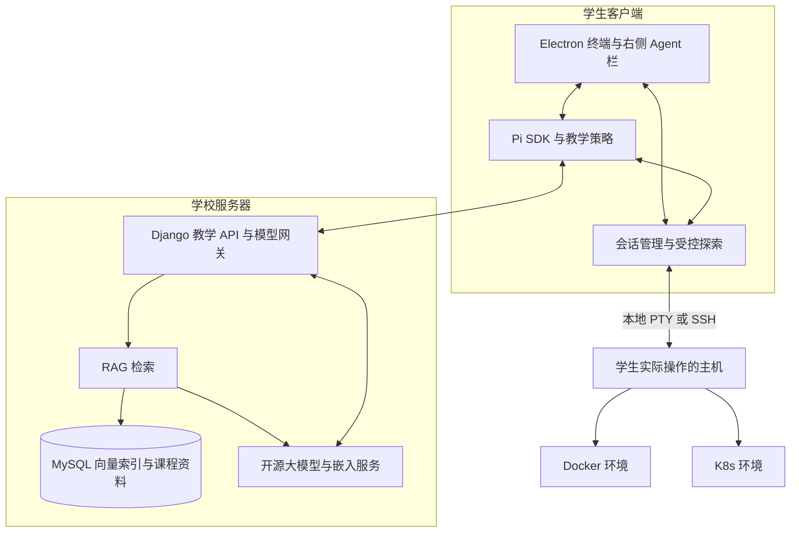

# 计算机命令行教学智能体项目设计方案检查报告

检查日期：2026 年 10 月 31 日。

> 本文件为补充前的初次检查记录。当前 a–e 已补充至[项目设计方案.md](项目设计方案.md)，最新判断见[项目设计方案复查报告.md](项目设计方案复查报告.md)；下文旧结论保留用于对照，不作为当前完成状态。

## 一 检查结论

当前设计方向符合“从计算机教学智能体中选择一个功能点”的要求。项目已收敛为**面向学生的环境感知型命令行教学助手**，以类似 MobaXterm 的桌面终端为载体，在右侧提供内置 Agent 对话栏。Windows PowerShell 7、Linux、Docker、K8s 和 SSH 是该功能覆盖的使用场景，不需要拆成五个独立项目。

现有材料已形成较完整的架构设计，但**还不能认定两类作业交付物已经全部完成**：设计方案需要进一步补足论证、数据细节、部署参数和费用口径；Git 仓库所要求的实际文件与 Django 骨架尚未创建。

本报告按作业原文逐项检查，并给出可直接用于后续设计文档的补充内容。只审查和完善设计，不实现业务功能、不安装项目依赖、不创建或发布 Git 仓库。

### 检查依据

- [需求原文](references/新建%20文本文档.txt)
- [需求整理](需求整理.md)
- [架构设计](架构设计.md)
- [同类项目调研](同类项目调研.md)
- 已查看的课堂白板照片，以及当前项目目录中的实际文件。

### 要求与现状对照

| 作业要求 | 检查结果 | 当前依据 | 主要待补内容 |
|---|---|---|---|
| a 功能的介绍 | 设计基本满足 | 架构设计第 1、3、4、6、10 节 | 汇总为正式功能介绍，明确典型教学情境 |
| b 大模型介入是否合理 | 已有方案，论证需加强 | 架构设计第 4、6、7 节 | 与规则方案比较，解释提示词、工具调用、RAG 的分工及不微调的原因 |
| c 数据来源 | 部分满足 | 架构设计第 7、9 节 | 资料清单、采集流程、版本与授权、初始数据准备 |
| c 数据库设计 | 概念设计基本满足 | 已有 9 张业务表及关系 | 字段类型、主外键、唯一约束、索引、删除与保留规则 |
| c 项目可行性 | 有技术依据，缺专项论证 | 已有同类调研与组件分工 | 数据可得性、工作量、关键限制和未来验证方案 |
| d 部署与运维 | 框架基本满足 | 架构设计第 2、11 节 | 节点资源、上线顺序、监控和备份策略、故障处置责任 |
| e 硬件与费用 | 仅有部分预算，尚不完整 | 需求整理三套单机硬件清单 | 完整部署总价、模型适配依据、存储网络及持续成本 |
| Git 仓库 README | 未交付 | 当前目录无 `README.md` | 创建实际文件 |
| Git 仓库 Makefile | 未交付 | 当前目录无 `Makefile` | 创建实际命令入口 |
| Git 仓库 requirements.txt | 未交付 | 当前目录无 `requirements.txt` | 创建 Python 依赖清单 |
| Git 仓库 Django 框架 | 未交付 | 当前目录无 Django 项目目录和代码 | 创建 Project、APP、views 等骨架 |

当前目录未发现 `.git`，也未提供本项目的 GitHub/Gitee 仓库地址。因此不能将文档中的建议目录图视为已经交付的 Git 仓库。

## 二 a 功能的介绍

### 已有设计是否满足

基本满足。服务对象、产品形态、目标环境、Agent 能力和操作边界均已明确。建议正式设计方案使用下面的统一描述，避免继续沿用早期“禁止 Agent 执行任何命令”的表述。

### 建议采用的功能描述

本项目面向学习计算机命令行与系统实验的学生，设计一款内置教学 Agent 的桌面终端客户端。应用左侧管理连接，中间提供学生实际使用的终端，右侧提供教学对话栏。

学生在 Windows PowerShell 7、Linux、本地或 SSH 远程终端中操作时，助手能够结合已有输出和环境信息理解问题，按需执行探查命令、读取结果，并检索课程资料，提供原因解释、命令讲解、分步提示和候选操作命令。

Agent 可以自主调查和验证；练习与实际修复由学生输入、执行。SSH 目标主机无需安装 AI Agent、模型或常驻采集器，学生也无需另装外部 Agent CLI。

### 功能范围

| 功能 | 设计范围 |
|---|---|
| 终端与连接 | 本地 PowerShell 7、Linux Shell、SSH 连接及多会话管理 |
| 环境感知 | 当前目标、目录、Shell、相关环境及终端输出；无法确认的字段标为未知 |
| 自主探索 | 根据问题逐步检查文件、日志、进程、容器或集群状态 |
| 教学解释 | 解释概念、参数、失败原因及建议操作的预期结果 |
| 课程检索 | 引用教师资料、官方手册和经审核案例 |
| 学习记录 | 保存选定的教学摘要、探索事件及学生反馈 |

首期设计以 PowerShell 7 与 Bash 为 Shell 基线。Docker、K8s 通过已有工具或 API 适配进行探索；并非要求一次实现全部终端、全部 Linux 发行版或完整运维平台。

### 典型使用流程

1. 学生在客户端建立 SSH 连接，进入实验目录并执行自己的命令。
2. 操作报错后，在右侧问“为什么我的容器启动后退出了”。
3. Agent 识别当前连接及 Docker 目标，检查状态、退出码和相关日志。
4. 根据返回证据继续调查；需要解释概念时检索课程资料。
5. 侧栏展示判断依据、概念解释和建议命令。
6. 学生自行完成修复，助手根据新的输出继续指导。

## 三 b 大模型介入的方式是否合理

### 检查发现

现有设计说明了“使用 Pi、工具调用和 RAG”，但还需回答**为什么这些能力需要大模型，以及哪些部分无需大模型**。技术组件清单本身不等于合理性论证。

### 大模型的必要性

学生的提问通常是不完整的自然语言，例如“找不到文件”“装好了但不能用”“容器访问不了”。相同表述可能来自不同 Shell、目录、虚拟环境、容器或集群。若只依赖错误关键词和固定规则，需要维护大量情境分支，仍难以解释未预先登记的组合问题。

大模型适合将自然语言意图、终端反馈、环境证据和课程知识结合起来，选择下一步调查方向，并将结果转化为适合学生理解的解释。规则与程序则负责提供真实状态、执行控制和数据校验。

以“找不到 Python 文件”为例，模型可以考虑目录、路径、文件名和环境等不同可能原因，选择需要的证据；但文件是否存在、当前工作目录是什么，应由工具返回，不能由模型猜测。

### 介入方式及取舍

| 方式 | 本项目中的作用 | 选择理由 |
|---|---|---|
| 教学提示词 | 定义教师式回答、分级提示与学生操作边界 | 便于随课程和任务调整 |
| 工具调用 | 获取实时环境、执行探索、回收结果并继续分析 | 教材和模型参数无法反映学生当前机器状态 |
| RAG | 检索课程资料、版本匹配的手册和案例，并提供出处 | 资料可更新，便于约束课程范围和核对解释 |
| 模型微调 | 本阶段不采用 | 当前没有经清洗、授权和标注的足量教学样本；设计阶段无需引入训练成本 |

Pi 是客户端 Agent 运行时，负责对话、模型调用和工具循环；大模型负责理解与规划；RAG 提供教学知识。三者职责不同。[Pi SDK](https://pi.dev/docs/latest/sdk)

### 模型与程序的边界

- 模型决定调查方向、组织解释和生成建议，不自行宣称未验证的环境事实。
- 程序维护执行目标、会话标识、权限、超时、输出限额和取消状态。
- 教学操作不自动写入学生终端；是否属于探索还需结合任务目标判断。
- 文件、日志和终端输出属于外部证据，不能作为新的执行授权。
- 命令风险不能仅凭模型分类或命令名称判断；复杂验证优先安排在隔离实验环境。

### 未来如何验证合理性

正式方案可设置“固定手册检索”“大模型加环境工具”“大模型加环境工具及 RAG”三种方案作对照，比较目标环境识别、结论证据、命令语法、资料引用和学生理解情况。本次只设计评估方法，不声称已经取得正确率、提分或性能结果。

## 四 c 数据来源 数据库设计与项目可行性

### 数据来源与处理

| 数据类别 | 获取来源 | 采集和处理方式 | 主要用途 |
|---|---|---|---|
| 课程知识 | 教师提供并授权的课件、实验指导、知识点说明 | 人工登记课程与版本，审核后切分入库 | 课程 RAG |
| 命令资料 | PowerShell、Linux 工具、Docker、Kubernetes 官方文档 | 保存来源、适用版本与更新日期，按许可使用 | 参数解释和版本核对 |
| 教学案例 | 教师编写案例、隔离实验环境中的可复现实例 | 记录现象、环境、原因和验证过程 | 错误分析与分级提示 |
| 实时环境 | 应用管理的本地终端、SSH 输出和主动探查结果 | 绑定会话与时间，裁剪并筛除敏感内容 | 当前问题诊断 |
| 学习记录 | 学生提问、操作后反馈、选定探索事件 | 明确告知记录范围，默认不上传完整终端历史 | 教学复盘 |

初始资料不依赖尚不存在的历史学生数据。可以先由教师准备一组覆盖路径、权限、环境变量、容器生命周期与 K8s 基础资源的实验资料和案例。资料数量属于后续准备计划，不能在方案中写成已经收集完成。

资料入库流程：**来源登记 → 权限与版本审核 → 文本整理 → 切分 → 生成嵌入 → 写入向量索引 → 保存出处与业务关联**。知识检索按课程权限过滤，实时机器状态不写成长期教材知识。

### 数据库方案

采用 MySQL 保存结构化业务数据，Qdrant 保存向量索引，文件存储保存原始教学资料。Django 本地框架演示可使用 SQLite；这属于开发便利，不改变生产数据库设计。

现有设计已给出表名与主要关系。建议补充为以下逻辑字段设计，具体迁移文件不在本轮实现。

| 表 | 建议主要字段及类型 | 约束和关系 |
|---|---|---|
| `users` | `id BIGINT`、`username VARCHAR(150)`、`role VARCHAR(20)`、`created_at DATETIME` | 使用 Django 用户体系，用户名唯一；不另设明文密码字段 |
| `courses` | `id BIGINT`、`name VARCHAR(200)`、`owner_id BIGINT`、`description TEXT` | `owner_id` 关联用户 |
| `enrollments` | `id BIGINT`、`user_id BIGINT`、`course_id BIGINT`、`role VARCHAR(20)` | 用户与课程组合唯一 |
| `lab_tasks` | `id BIGINT`、`course_id BIGINT`、`title VARCHAR(200)`、`objective TEXT`、`guidance_policy JSON` | 一门课程对应多个任务 |
| `knowledge_documents` | `id BIGINT`、`course_id BIGINT`、`title VARCHAR(200)`、`source_uri TEXT`、`version VARCHAR(100)`、`status VARCHAR(20)` | 文档关联课程，保留来源及审核状态 |
| `knowledge_chunks` | `id BIGINT`、`document_id BIGINT`、`ordinal INT`、`text LONGTEXT`、`vector_id VARCHAR(100)` | 文档与序号组合唯一，向量标识唯一 |
| `learning_conversations` | `id BIGINT`、`user_id BIGINT`、`task_id BIGINT NULL`、`client_session_id VARCHAR(100)`、`summary TEXT`、`created_at DATETIME` | 用户对应多次对话，任务可空 |
| `learning_events` | `id BIGINT`、`conversation_id BIGINT`、`client_event_id VARCHAR(100)`、`kind VARCHAR(30)`、`payload JSON`、`occurred_at DATETIME` | 对话与客户端事件标识组合唯一，支持重传去重 |
| `feedback` | `id BIGINT`、`conversation_id BIGINT`、`rating SMALLINT`、`comment TEXT`、`created_at DATETIME` | 关联对话，评分范围需应用校验 |

主要关系：用户通过选课记录关联课程；课程关联任务与资料；资料关联片段；学生关联教学对话；对话关联探索事件和反馈。

建议对课程归属、文档归属，以及事件的 `conversation_id + occurred_at` 建索引。Qdrant 元数据保存 `course_id`、`document_id`、`chunk_id` 和版本，以便过滤和回溯。跨 MySQL 与向量库的删除需要设计同步流程，不能当作普通数据库外键自动保证。

本地 Pi 会话负责 Agent 运行上下文，服务端只保存教学摘要和选定事件。连接凭据不进入服务端业务库。资料和教学数据的删除、归档及保留周期应在正式方案中写清，并与学校要求一致。

### 可行性判断

**技术上具备设计依据。** Electron 负责桌面与系统能力；Pi SDK 提供可嵌入的 Agent 能力；SSH 支持远端命令；Django 承担教学业务；RAG 采用独立资料索引。现有同类项目可作为机制参考，但不能代替本项目的兼容性验证。[Pi 自定义及远端工具](https://pi.dev/docs/latest/extensions#remote-execution)、[OpenSSH](https://man.openbsd.org/ssh)

**数据上可以从课程材料起步。** 不需要一开始就取得大量真实学生历史记录，也不需要自行训练基础模型。

**工作量应按框架作业控制。** 当前只需要说明组件关系、接口与数据模型，以及后续骨架目录；不需要实现完整桌面终端、SSH 状态跟踪、模型推理或 K8s 集群。

### 必须说明的技术限制

1. 独立 SSH exec 通道不能自动继承学生交互 Shell 的目录、虚拟环境、函数与别名。
2. 必须依赖当前 Shell 的探测，需要在终端空闲时协调，不能把命令写入密码提示或前台交互程序。
3. 进入容器、Pod、切换用户或嵌套 SSH 后，原上下文可能失效；无法确认时标为未知。
4. 模型能否稳定产生工具调用，以及量化后能否完成多步调查，属于后续验证项。
5. “远端无需 Agent”不等于“远端不执行任何代码”；探索使用已有 Shell 和工具，但不要求部署常驻 AI 组件。

## 五 d 部署方案与后期运维

### 总体分工

**客户端维护 Agent 循环，Django 提供教学业务和模型接入，目标机器执行探索。** 不在 Django 中重复维护第二套工具循环。



终端到目标主机的 SSH 流量不由教学服务器转发。模型所需的环境证据由客户端选取后发送；服务器模型返回工具请求，再由客户端 Pi 与执行层处理。

### 部署层次

| 部署位置 | 组件 | 说明 |
|---|---|---|
| 学生电脑 | Electron、Pi SDK、本地终端/SSH 管理 | 无需本地大模型 GPU，无需额外 Agent CLI |
| 业务节点 | Django ASGI 服务与模型网关逻辑 | 负责认证、检索入口、教学记录及请求控制 |
| 数据服务 | MySQL、Qdrant、原文存储 | 使用持久存储并安排备份 |
| GPU 节点 | 开源大模型推理服务 | 与业务服务分离，限制资源占用 |
| 嵌入服务 | 文档和问题向量化 | 小规模可单独在 CPU 服务运行，实际资源需按选定模型评估 |
| 教学目标主机 | 已有 SSH、Docker 或 kubectl 等工具 | 不安装 AI Agent，沿用学生实际权限 |

若采用课堂白板中的 K8s 部署，设计为控制平面、业务 Worker 与 GPU Worker。学生学习的 K8s 集群与承载本项目服务的 K8s 集群是不同角色，不能在图中混为一体。

正式方案仍应补充各节点 CPU、内存、磁盘、网络和持久卷规格。单机演示可将多个逻辑角色合并，但必须标明它不是多节点高可用集群。

### 上线流程设计

1. 明确模型、量化文件、推理引擎及客户端 Pi 的版本组合，核对许可和接口。
2. 准备数据库、资料存储和向量服务，配置持久卷及备份位置。
3. 部署模型与嵌入服务，确认文本流和工具调用协议。
4. 部署 Django，配置密钥、数据库连接、课程权限、HTTPS 和模型地址。
5. 由教师导入一组课程资料与案例，核对索引和来源引用。
6. 发布客户端配置，先做小范围教学试用，再扩大使用范围。

以上是未来上线步骤，本项目框架阶段不执行部署。

### 运维设计

| 事项 | 建议策略 | 故障处理 |
|---|---|---|
| API 与模型 | 监控请求失败、延迟、超时及 GPU 内存 | 保留普通终端使用，侧栏明确显示教学服务不可用 |
| SSH 与探索 | 记录连接状态、目标标识、超时及取消结果 | 连接变化后使旧运行失效，避免误投其他主机 |
| 数据备份 | 建议数据库每日备份；资料按版本保存；定期验证恢复 | 向量索引可从资料和片段重建，不能只备份向量库 |
| 日志管理 | 区分应用日志与选定学习记录，裁剪、脱敏并设保留期 | 凭据和完整终端历史不作为常规应用日志上传 |
| 模型与知识更新 | 记录模型版本，回归检查典型教学案例；资料重建索引 | 保留上一可用版本，异常时回退 |
| 客户端更新 | 维护客户端、Pi、工具协议兼容表 | 服务端能识别不兼容版本并提示升级 |

备份频率和保留周期是设计建议，尚未形成已验证的恢复时限或服务可用性承诺。正式方案应指定学校管理者、教师和维护人员各自职责。

## 六 e 甲方部署费用与硬件要求

### 现有费用核算

需求整理已提供三套硬件及单价。按该单价复核，三套单机的加法均正确：

| 项目 | 方案一 | 方案二 | 方案三 |
|---|---:|---:|---:|
| Tesla T10 16G | 4 × 1500 = 6000 元 | 4 × 1500 = 6000 元 | 2 × 1500 = 3000 元 |
| 内存 | DDR3 256G 2000 元 | DDR3 64G 500 元 | DDR4 32G 1000 元 |
| 主板 | 1000 元 | 1000 元 | 1000 元 |
| CPU | 500 元 | 500 元 | 500 元 |
| NVMe 1TB | 800 元 | 800 元 | 800 元 |
| 电源 | 1000 元 | 1000 元 | 1000 元 |
| 机箱 | 200 元 | 200 元 | 200 元 |
| **单机硬件小计** | **11500 元** | **10000 元** | **7500 元** |

这些数字沿用项目材料的预算输入，**本次只核算合计，不把它们视为已核实的当前市场报价，也不视为完整部署总价**。

### 现有硬件描述需要修正的地方

- 方案二和方案三的参数规模分别写为 27B 与 35B，不能称三套模型“参数规模逐级递减”。MoE 的总参数和激活参数也不能混用。
- 不能仅凭多卡总显存相加，就认定指定量化模型、上下文与并发一定可运行；还需考虑量化元数据、运行缓冲、缓存、分卡方式及推理引擎支持。
- 125B 模型按每参数 4 bit 作粗略理论估算，仅权重数据就约 62.5 GB，尚不含上述额外占用。这只是容量下界计算，不能作为四卡部署成功的证据。
- 不应笼统写“三套都是 MoE”。模型架构、完整名称、权重来源与量化格式应分别核对。
- “四通道服务器内存不构成瓶颈”“PCIe 张量并行可直接采用”等结论缺少具体平台和软件依据，应改为待验证项。
- 应补充主板与 CPU 型号、PCIe 插槽及通道、机箱空间、散热、供电和网卡规格。型号与兼容性不明确时，清单金额不能证明硬件可装配。

公开的官方资料可确认 Qwen3.8-27B、Qwen3.6-35B-A3B 等模型条目，但模型存在不等于本项目的 T10 配置适配已经验证。方案一所写的完整模型名称与权重出处仍应在正式选型表中列明。[Qwen 官方仓库](https://github.com/QwenLM/Qwen3.8)、[Qwen3.6-35B-A3B 官方模型卡](https://huggingface.co/Qwen/Qwen3.6-35B-A3B)

### 完整部署预算缺少哪些内容

| 费用范围 | 当前是否包含 | 正式方案应补充 |
|---|---|---|
| GPU 推理单机 | 有初步清单 | 精确型号、兼容性、采购来源与报价日期 |
| Django 业务资源 | 未单列 | CPU、内存、磁盘及复用/新增采购方式 |
| MySQL 与向量服务 | 未单列 | 数据容量、索引空间、持久存储和备份 |
| K8s 控制及业务节点 | 未单列 | 复用的实体机/虚拟机，或新增节点费用 |
| 网络和机房配套 | 未单列 | 网卡、交换资源、带宽、供电与散热条件 |
| 部署与持续维护 | 未单列 | 部署人工、电费、备份与后续维护 |

建议正式费用表同时提供两种口径：

1. **复用学校资源的试点方案**：已有业务服务器、网络和备份资源不新增采购，逐项注明“复用”；列出新增 GPU 单机费用。不能因此将复用资源的长期成本表述为不存在。
2. **全部新增的完整部署方案**：在选定 GPU 单机小计上，加业务节点、数据存储、控制节点、网络配套与部署维护成本。

预算表达式为：**首次部署费用 = 选定推理单机费用 + 新增业务及数据资源 + 控制节点及网络配套 + 部署人工**。持续成本另列，不混入单机硬件小计。

正式方案还应给出设计负载，例如覆盖一个班级、允许多少学生同时连接、限制多少并发模型请求，以及上下文长度。这些是容量规划假设，不是已测性能。缺少负载假设，不能比较三套硬件的教学可用性。

因此，e 项当前应判定为**部分满足，预算尚未闭合**。本报告不虚构尚无型号和报价依据的整套采购总额。

## 七 Git 项目仓库检查

### 实际状态

检查时，项目根目录只有需求原文、白板照片、需求整理、架构设计和同类调研。没有发现 README、Makefile、requirements.txt、Django 目录或 `.git`。

现有《架构设计》中的目录树是设计说明，不能替代实际仓库文件。“项目无需完整实现”允许业务占位，但并不免除提交仓库框架的要求。

### 四项文件分别需要包含什么

| 要求 | 最小框架内容 | 不要求完成的内容 |
|---|---|---|
| `README.md` | 背景、唯一功能点、架构、目录、准备条件、命令说明、已实现与占位状态 | 不要求声称已有可用完整产品 |
| `Makefile` | 依赖准备、Django 检查、迁移、启动等入口及环境变量说明 | 不要求一键部署真实 GPU/K8s |
| `requirements.txt` | Django 及骨架实际导入的 Python 依赖，实施时锁定版本 | 不把 Electron/Pi 的 npm 依赖写进 Python 清单 |
| Django 框架 | `manage.py`、Project settings/urls/asgi/wsgi、APP 与 views/urls 等 | 不要求接通 Pi、SSH、RAG 或模型 |

Electron 与 Pi 的依赖在未来 `desktop/package.json` 中声明，这是桌面框架的补充文件，不能替代老师要求的 `requirements.txt`。

Windows 文档应说明 GNU Make 的准备方式，并给出等价 PowerShell 7 命令。Python 命令按项目约定使用 Conda 环境，例如 `D:\anaconda\envs\py311\python.exe`；不要求为了框架作业安装完整模型推理依赖。

### 建议的最小 Django 骨架

```text
project/
├── README.md
├── Makefile
├── requirements.txt
├── docs/
│   └── 项目设计方案.md
├── desktop/
│   └── README.md                 # 桌面模块和 Pi 接入设计，可先不实现
└── backend/
    ├── manage.py
    ├── config/
    │   ├── __init__.py
    │   ├── settings.py
    │   ├── urls.py
    │   ├── asgi.py
    │   └── wsgi.py
    └── apps/
        ├── __init__.py
        ├── accounts/
        ├── courses/
        ├── knowledge/
        ├── learning/
        └── model_gateway/
```

各 APP 后续按 Django 习惯放置 `__init__.py`、`apps.py`、`models.py`、`views.py`、`urls.py` 和 `migrations/__init__.py`。占位接口应明确表示未实现，不能返回伪造的模型或探索结果。

本次仅提供目录和验收标准，没有创建上述代码。仓库验收至少确认必需文件存在、Project 到 APP 的路由关系清楚、导入和 Django 配置检查通过、README 与实际状态一致，并提供可访问的 GitHub/Gitee 地址；不要求端到端业务可用。

## 八 当前材料中的一致性问题

1. **技术基线的状态不统一。** 需求整理仍将客户端框架与 Pi 放在评估状态，架构设计已采用 Electron、客户端 Pi 与 Django 的分工。正式方案应统一写成“本方案采用的设计基线”，并注明未完成实现验证。
2. **硬件结论的口径不统一。** 需求整理使用“已确定，直接采用”，架构设计则指出模型与硬件待核实。正式方案应区分已有预算输入与已验证部署配置。
3. **评分重点的来源需区分。** 需求整理把 b 项写作“评分重点”，但需求原文并未给出评分权重。可以重视合理性论证，不能把这一判断写成老师明确公布的评分规则。
4. **框架设计与仓库交付需区分。** 完整业务不必实现，但最终仍需实际 Git 骨架。当前只有文档不能判为第二项已完成。

## 九 建议的完成顺序

1. 将功能、模型论证、数据、部署和费用按 a–e 汇总为一份正式《项目设计方案》，统一产品与执行边界。
2. 补足模型选型证据、部署规格和预算口径；不能在未验证时承诺并发量或模型运行效果。
3. 按最小目录建立 Git 骨架，实际提供四项必需交付物，业务保持占位即可。
4. 完成与骨架相适应的配置检查，补全 README 中的运行条件与未实现说明。
5. 提交仓库地址和方案文档，检查文档中的文件、接口和状态与仓库一致。

**最终判定：项目选题与总体架构成立；a 项基本满足，b–e 项需要不同程度补充，Git 仓库四项尚未交付。当前适合继续完成设计文档和最小骨架，不需要开展完整功能开发。**

## 十 参考资料

- [Pi SDK 官方文档](https://pi.dev/docs/latest/sdk)
- [Pi 自定义及远端执行工具](https://pi.dev/docs/latest/extensions#remote-execution)
- [Electron 进程模型](https://www.electronjs.org/docs/latest/tutorial/process-model)
- [OpenSSH 远端登录与命令执行](https://man.openbsd.org/ssh)
- [Clide 终端交互参考](https://github.com/DLbury/clide)
- [Qwen 官方模型资料](https://github.com/QwenLM/Qwen3.8)
- [Qwen3.6-35B-A3B 官方模型卡](https://huggingface.co/Qwen/Qwen3.6-35B-A3B)
